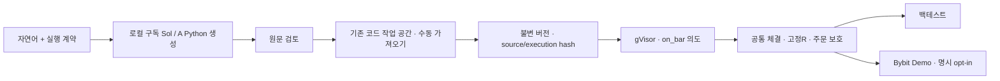

# 생성 전략 평가와 권고 실행 구조

[ADR-046](../adr/046-generated-strategy-language-evaluation.md)의 사전 고정 정책은
**A: 직접 생성 / Python**을 선택했다. 로컬 구독 Sol CLI로 생성하고 원문을 검토한 뒤
기존 `/strategies/code`에서 저장·백테스트하는 경로를 권고한다.
**생성·의미 검증 1,350건과 경제 평가 1,440셀을 종결했다. 경제 기준 통과는 0이다.**
이 문서의 순위는 수익률 순위 또는 실주문 승인과 다르다.

## 평가 분모와 점수

30전략 × 5반복 × 3생성 방식 × 3언어 = **1,350건**을 모두 종결했다.
세 방식은 A 원문 1회 생성, B 공개 오류 수정 최대 2회 추가, C 닫힌 명세 생성과
결정론 컴파일 최대 2회 추가다. 각 요청은 별도 `gpt-6.1-sol/high` Codex CLI 요청이다.
실제 응답 모델 ID와 구독의 실청구 USD는 미관측이며 API 가격으로 환산하지 않는다.

선정 지표는 전략별 5회 평균을 먼저 낸 뒤 30전략을 같은 비중으로 합산한 `quality90`이다.
계약40·원장25·재현15·공개 실행 proxy10점으로 구성한다. 효율10점을 더한 `score100`은
함께 보고하되 선정 기준으로 바꾸지 않는다. 점수와 이진 의미 통과율을 구분한다.

| 순위 | 방식 / 언어 | 품질 /90 | 종합 /100 | 의미 통과 /150 | 생성 p50 / p95초 |
| --- | --- | ---: | ---: | ---: | ---: |
| 1 | A / Python | 89.2133 | 96.8902 | 142 | 54.87 / 100.54 |
| 2 | B / Python | 89.0613 | 96.6967 | 141 | 57.23 / 97.35 |
| 3 | B / TypeScript | 88.4613 | 95.9751 | 140 | 57.91 / 98.87 |
| 4 | A / TypeScript | 88.2366 | 95.5677 | 141 | 62.44 / 104.47 |
| 5 | B / Pine | 87.8878 | 95.3344 | 136 | 59.85 / 109.39 |
| 6 | A / Pine | 83.3996 | 90.4447 | 135 | 59.06 / 96.32 |
| 7 | C / TypeScript | 67.9595 | 75.2992 | 98 | 40.95 / 177.68 |
| 8 | C / Python | 67.1996 | 74.3293 | 98 | 38.03 / 180.01 |
| 9 | C / Pine | 66.9591 | 74.1041 | 96 | 38.50 / 180.01 |

모든 조합의 분모는 150이다. 실패·시간 초과·미지원도 유지했다. 생성 시간은 관측된
모든 attempt의 누적 시간이며 native 실행 시간이나 API 요금이 아니다.

A/Python과 B/Python의 품질 차이는 **0.15197점**이다. 고정 30전략 단위의 paired
bootstrap 20,000회(seed 20261022) 95% 구간은 **[-0.10718, 0.56309]**, family95 구간은
**[-0.14314, 0.75094]**다. 모두 0을 포함한다. 따라서 사전 정책의 관측 1위와
확정적인 우월성을 구분한다. 이 통계는 고정 카탈로그의 기술 통계이며 모집단 일반화나
선정 후 편향 해소를 증명하지 않는다.

B/Python과 B/TypeScript에서는 공개 오류 수정이 실제로 호출되지 않았다.
B/Pine은 추가 9호출로 공개 통과가 141→149건으로 증가했다. 이 관측을 모든 언어의
수정 효과로 확대하지 않는다. C compiler는 22종을 표현하며 나머지 8종도 전체 분모에
포함했다. C 방식 일반의 우열과 이번 닫힌 명세의 표현 범위를 구분한다.

## 30개 방법과 공통 주문 계약

롱·숏·무효화 조건과 공식 지표 출처는 [30전략 카탈로그](../domain/futures-strategy-catalogue.md)가
갖는다. 실행 가능한 규칙 데이터는 [strategy_catalogue30.py](../../tools/research/strategy_catalogue30.py),
독립 신호 기준은 [strategy_oracle.py](../../tools/research/strategy_oracle.py)다.
실제 생성 원문·요청·usage·해시는 `runs/`에 보존하며 개발 명세 컴파일 결과를 LLM 점수로 세지 않는다.

실제 진입가 E와 신호 봉·그 이전 완료 봉 극값 사이 거리의 1.1배를 최초 R로 고정한다.
손실 방향 1R에 SL, 이익 방향 1.5R에 최초 수량 50% 청산, 2R부터 비용 전 본절과
2R 거리 trailing을 적용한다. 10%는 **가격 자체가 아닌 위험 거리의 버퍼**라는 연구 가정이다.
무효화는 잔량 청산이다. 연구 원장은 반대 신호를 청산 뒤 새 진입으로 처리한다.
제품 Demo는 실제 flat·보호 취소를 확인한 뒤 **다음 평가의 새로운 같은 방향 의도**가 있어야
새 수량·직전 2봉으로 진입한다. 이전 반대 의도를 지연 발동하지 않는다.
이 [주문 계약](../domain/code-risk-execution.md)과 수량·수수료·펀딩은 생성 코드가 아닌 공통 실행 계층이 소유한다.

## 경제 평가

봉인 후보는 A/Python이며 각 전략의 첫 semantic pass를 고정했다.
30종 모두 최소 한 번 통과했다. 전략16은 반복2, 전략29는 반복1, 나머지는 반복0이다.
수익률을 보고 언어·방식·반복을 다시 선택하지 않는다.

동결한 24개월 부모봉과 그 안에 포함된 6개월 1분 실행 자료, 두 심볼·세 주기·네 비용
시나리오의 **1,440셀(720+720)**을 유지한다. 지원 주기·펀딩 자료 조건에 따른 N/A와
실행 실패도 분모에 남긴다. 6개월 계열을 독립 holdout으로 부르지 않으며 관측 펀딩의
가격은 OHLC 시가 proxy다. 부호를 유지한 펀딩 2배는 수취 포지션에 유리할 수도 있다.

무료 표준 ARM에 40개 논리 shard를 요청하며 각 host는 4 process·36셀을 담당한다.
실제 동시 실행은 계정 한도와 queue 상태를 따른다. plan SHA는
`2b4a8733076041a08562e6ba34d6fc32b59f84f09a0fbc7fd37ba4bfe5bb592f`다.
입력 12개 묶음의 Mac/ARM Linux 원 loader 해시 동일성을 별도 확인했으며,
이 사실만으로 전체 수치 계산·timeout·성과가 동등하다고 주장하지 않는다.

최종 실제 driver는 exit 0으로 종료했다. **성공 1,159 · 실행 실패 9 · N/A 272 = 1,440셀**이다.
두 family·30전략·네 시나리오의 모든 원 요약에서 `economic_threshold_passes=0`이다.
따라서 이번 선정은 **생성 계약 품질의 관측 1위**이며, 수익성 기준을 통과한 매매 후보는 없다.
통과 0을 모든 셀의 적자로 해석하지 않는다. 양의 수익이 있어도 복합 기준이나 자료 완전성을
충족하지 않을 수 있다. 예를 들어 전략08의 분봉 baseline BTC/ETH 1h 두 셀은 양의 수익과
PF≥1.1·DD≤0.25·거래30건을 보였으나 `funding_data_incomplete=null`로, 원 판정이 요구하는
명시적 `False`의 증거가 없다. 이 두 예시를 전체 통과 0의 원인으로 일반화하지 않는다.

원 기준은 순수익>0·PF≥1.1·절대DD≤0.25·거래≥30·`funding_data_incomplete is False`의
동시 충족이다. 실패 9건은 부모봉 전략16의 BTC/ETH 1h 네 시나리오 8건과 전략12의
ETH 1h 펀딩2배 1건의 `PythonRunnerTimeout`이다. 실패를 0수익이나 모델 의미 오류로
바꾸지 않았고 재시도로 후보를 바꾸지 않았다. N/A는 원 지원 주기와 일봉의 분봉 실행 요구를 따른다.
연구는 현재 자산100%·1배·다음 봉 시가 체결이다. 제품의 저장 allocation과 실제 Demo 체결로
같은 수익이 재현된다는 뜻이 아니다. B/C 후보의 경제 성과는 별도로 측정하지 않았다.

계획 분모는 family별720셀·전략별24셀(2심볼×3TF×4scenario), 전체1,440셀이다. 성공·실패·N_A를 모두 보존하며 누락/실패를0수익으로 바꾸지 않는다. 기본 중앙값·최소 수익·최대절대DD는 baseline에서 **성공한 고유 signal-cell에 조건부**다. 두 기간은 중첩되며 독립 holdout이 아니다.

수익·DD는 원 **ratio/fraction 단위**다. Markdown의 세 기본 수치만 **6유효자리 표시 반올림**하며 CSV는 원 Decimal 문자열 전체를 보존한다. B/C/S/F는 기본/수수료2배/슬리피지2배/펀딩2배이며 각 쌍은 원 `economic_threshold_passes/unique_signal_cells`다. 펀딩 부호는 유지한다. 스트레스 누락 표시는 원 `all_stress_scenarios_present`의 부정이다. 회고 기준 통과는 미래 수익·실주문·운영 승인이 아니다.

### historical_parent

원 분모720 / 성공463 / 실패9 / N_A248.

| 전략 | 성공/실패/N_A (계획24) | 기본 중앙값 | 기본 최소 수익 | 기본 최대절대DD | B/C/S/F 통과/고유셀 | 스트레스 누락? |
| --- | ---: | ---: | ---: | ---: | --- | --- |
| 01 EMA 20/50 교차 | 16/0/8 | -0.460023 | -0.596810 | 0.673797 | 0/4 · 0/4 · 0/4 · 0/4 | false |
| 02 EMA 추세 눌림 복귀 | 16/0/8 | -0.639430 | -0.854914 | 0.874334 | 0/4 · 0/4 · 0/4 · 0/4 | false |
| 03 Donchian 20 돌파 | 16/0/8 | -0.533657 | -0.827001 | 0.844869 | 0/4 · 0/4 · 0/4 · 0/4 | false |
| 04 Turtle 55/20 | 16/0/8 | -0.427911 | -0.513716 | 0.569462 | 0/4 · 0/4 · 0/4 · 0/4 | false |
| 05 Supertrend 전환 | 16/0/8 | -0.302423 | -0.819988 | 0.824943 | 0/4 · 0/4 · 0/4 · 0/4 | false |
| 06 DMI ADX 추세 | 16/0/8 | -0.363254 | -0.618684 | 0.623967 | 0/4 · 0/4 · 0/4 · 0/4 | false |
| 07 Ichimoku 구름 확인 | 16/0/8 | -0.272003 | -0.518788 | 0.521963 | 0/4 · 0/4 · 0/4 · 0/4 | false |
| 08 Keltner 추세 돌파 | 16/0/8 | -0.209356 | -0.446140 | 0.505030 | 0/4 · 0/4 · 0/4 · 0/4 | false |
| 09 Bollinger squeeze 돌파 | 16/0/8 | -0.123705 | -0.215455 | 0.331290 | 0/4 · 0/4 · 0/4 · 0/4 | false |
| 10 ATR 확장 돌파 | 16/0/8 | -0.921909 | -0.998216 | 0.998220 | 0/4 · 0/4 · 0/4 · 0/4 | false |
| 11 RSI 중심선 추세 | 16/0/8 | -0.624103 | -0.847079 | 0.860836 | 0/4 · 0/4 · 0/4 · 0/4 | false |
| 12 Stochastic RSI 추세 | 15/1/8 | -0.581405 | -0.863732 | 0.865589 | 0/4 · 0/4 · 0/4 · 0/3 | false |
| 13 MACD signal 추세 | 16/0/8 | -0.510902 | -0.774267 | 0.793559 | 0/4 · 0/4 · 0/4 · 0/4 | false |
| 14 MACD 영선 교차 | 16/0/8 | -0.680897 | -0.823887 | 0.832829 | 0/4 · 0/4 · 0/4 · 0/4 | false |
| 15 ROC 추세 확인 | 16/0/8 | -0.766090 | -0.881565 | 0.902745 | 0/4 · 0/4 · 0/4 · 0/4 | false |
| 16 RSI 확정 pivot 다이버전스 | 8/8/8 | 0.00112503 | -0.150933 | 0.232448 | 0/2 · 0/2 · 0/2 · 0/2 | false |
| 17 Stochastic 추세 재개 | 16/0/8 | -0.456514 | -0.744174 | 0.753385 | 0/4 · 0/4 · 0/4 · 0/4 | false |
| 18 CCI 추세 확장 | 16/0/8 | -0.606773 | -0.830702 | 0.843082 | 0/4 · 0/4 · 0/4 · 0/4 | false |
| 19 Williams R 복귀 | 16/0/8 | -0.470345 | -0.877465 | 0.878725 | 0/4 · 0/4 · 0/4 · 0/4 | false |
| 20 TSI 추세 전환 | 16/0/8 | -0.450357 | -0.623063 | 0.658962 | 0/4 · 0/4 · 0/4 · 0/4 | false |
| 21 UTC 일중 VWAP 복귀 | 16/0/8 | -0.775317 | -0.881821 | 0.885529 | 0/4 · 0/4 · 0/4 · 0/4 | false |
| 22 Anchored VWAP 돌파 | 16/0/8 | 0.0422297 | -0.0285002 | 0.121400 | 0/4 · 0/4 · 0/4 · 0/4 | false |
| 23 OBV 확인 돌파 | 16/0/8 | -0.257991 | -0.662067 | 0.688637 | 0/4 · 0/4 · 0/4 · 0/4 | false |
| 24 CMF 추세 재개 | 16/0/8 | -0.570410 | -0.739619 | 0.739619 | 0/4 · 0/4 · 0/4 · 0/4 | false |
| 25 MFI 눌림 복귀 | 16/0/8 | -0.243614 | -0.484463 | 0.513208 | 0/4 · 0/4 · 0/4 · 0/4 | false |
| 26 Aroon 추세 시작 | 16/0/8 | -0.243901 | -0.392226 | 0.430347 | 0/4 · 0/4 · 0/4 · 0/4 | false |
| 27 선형회귀 채널 복귀 | 16/0/8 | -0.514082 | -0.654054 | 0.671415 | 0/4 · 0/4 · 0/4 · 0/4 | false |
| 28 Heikin Ashi 추세 확인 | 16/0/8 | -0.749652 | -0.978691 | 0.979106 | 0/4 · 0/4 · 0/4 · 0/4 | false |
| 29 Chandelier 추세 전환 | 16/0/8 | -0.469419 | -0.792844 | 0.814876 | 0/4 · 0/4 · 0/4 · 0/4 | false |
| 30 완료4h EMA regime | 8/0/16 | -0.532048 | -0.548768 | 0.575977 | 0/2 · 0/2 · 0/2 · 0/2 | false |

### minute_execution

원 분모720 / 성공696 / 실패0 / N_A24.

| 전략 | 성공/실패/N_A (계획24) | 기본 중앙값 | 기본 최소 수익 | 기본 최대절대DD | B/C/S/F 통과/고유셀 | 스트레스 누락? |
| --- | ---: | ---: | ---: | ---: | --- | --- |
| 01 EMA 20/50 교차 | 24/0/0 | -0.0794219 | -0.224170 | 0.347914 | 0/6 · 0/6 · 0/6 · 0/6 | false |
| 02 EMA 추세 눌림 복귀 | 24/0/0 | -0.177923 | -0.278964 | 0.373312 | 0/6 · 0/6 · 0/6 · 0/6 | false |
| 03 Donchian 20 돌파 | 24/0/0 | -0.214313 | -0.358307 | 0.416419 | 0/6 · 0/6 · 0/6 · 0/6 | false |
| 04 Turtle 55/20 | 24/0/0 | -0.0410717 | -0.386903 | 0.457536 | 0/6 · 0/6 · 0/6 · 0/6 | false |
| 05 Supertrend 전환 | 24/0/0 | -0.0468485 | -0.238442 | 0.326009 | 0/6 · 0/6 · 0/6 · 0/6 | false |
| 06 DMI ADX 추세 | 24/0/0 | -0.0481547 | -0.208844 | 0.242698 | 0/6 · 0/6 · 0/6 · 0/6 | false |
| 07 Ichimoku 구름 확인 | 24/0/0 | -0.0587335 | -0.0961194 | 0.179053 | 0/6 · 0/6 · 0/6 · 0/6 | false |
| 08 Keltner 추세 돌파 | 24/0/0 | 0.0784007 | -0.189242 | 0.242151 | 0/6 · 0/6 · 0/6 · 0/6 | false |
| 09 Bollinger squeeze 돌파 | 24/0/0 | 0.00121607 | -0.134420 | 0.166897 | 0/6 · 0/6 · 0/6 · 0/6 | false |
| 10 ATR 확장 돌파 | 24/0/0 | -0.102906 | -0.658765 | 0.670807 | 0/6 · 0/6 · 0/6 · 0/6 | false |
| 11 RSI 중심선 추세 | 24/0/0 | -0.0470263 | -0.286205 | 0.351569 | 0/6 · 0/6 · 0/6 · 0/6 | false |
| 12 Stochastic RSI 추세 | 24/0/0 | -0.0541406 | -0.372886 | 0.381678 | 0/6 · 0/6 · 0/6 · 0/6 | false |
| 13 MACD signal 추세 | 24/0/0 | -0.0280020 | -0.265333 | 0.379663 | 0/6 · 0/6 · 0/6 · 0/6 | false |
| 14 MACD 영선 교차 | 24/0/0 | -0.189910 | -0.386623 | 0.401174 | 0/6 · 0/6 · 0/6 · 0/6 | false |
| 15 ROC 추세 확인 | 24/0/0 | 0.0611768 | -0.278582 | 0.317561 | 0/6 · 0/6 · 0/6 · 0/6 | false |
| 16 RSI 확정 pivot 다이버전스 | 24/0/0 | -0.000603109 | -0.162849 | 0.162849 | 0/6 · 0/6 · 0/6 · 0/6 | false |
| 17 Stochastic 추세 재개 | 24/0/0 | -0.0206024 | -0.204351 | 0.277916 | 0/6 · 0/6 · 0/6 · 0/6 | false |
| 18 CCI 추세 확장 | 24/0/0 | -0.0472111 | -0.382094 | 0.420611 | 0/6 · 0/6 · 0/6 · 0/6 | false |
| 19 Williams R 복귀 | 24/0/0 | -0.107714 | -0.398805 | 0.416664 | 0/6 · 0/6 · 0/6 · 0/6 | false |
| 20 TSI 추세 전환 | 24/0/0 | -0.0267686 | -0.141245 | 0.204339 | 0/6 · 0/6 · 0/6 · 0/6 | false |
| 21 UTC 일중 VWAP 복귀 | 16/0/8 | -0.203337 | -0.396451 | 0.411881 | 0/4 · 0/4 · 0/4 · 0/4 | false |
| 22 Anchored VWAP 돌파 | 24/0/0 | -0.0333344 | -0.0626649 | 0.0946645 | 0/6 · 0/6 · 0/6 · 0/6 | false |
| 23 OBV 확인 돌파 | 24/0/0 | -0.0213824 | -0.302667 | 0.378980 | 0/6 · 0/6 · 0/6 · 0/6 | false |
| 24 CMF 추세 재개 | 24/0/0 | -0.0210522 | -0.147881 | 0.319099 | 0/6 · 0/6 · 0/6 · 0/6 | false |
| 25 MFI 눌림 복귀 | 24/0/0 | -0.112786 | -0.233557 | 0.241252 | 0/6 · 0/6 · 0/6 · 0/6 | false |
| 26 Aroon 추세 시작 | 24/0/0 | -0.0146796 | -0.137976 | 0.176017 | 0/6 · 0/6 · 0/6 · 0/6 | false |
| 27 선형회귀 채널 복귀 | 24/0/0 | -0.134997 | -0.248109 | 0.289590 | 0/6 · 0/6 · 0/6 · 0/6 | false |
| 28 Heikin Ashi 추세 확인 | 24/0/0 | -0.198578 | -0.533865 | 0.601080 | 0/6 · 0/6 · 0/6 · 0/6 | false |
| 29 Chandelier 추세 전환 | 24/0/0 | -0.0590293 | -0.244111 | 0.383338 | 0/6 · 0/6 · 0/6 · 0/6 | false |
| 30 완료4h EMA regime | 8/0/16 | -0.182779 | -0.272578 | 0.332004 | 0/2 · 0/2 · 0/2 · 0/2 | false |

## 운영 측정과 제품 연결

선정된 30개 원문을 같은 params·warmup의 준비 CodeSnapshot으로 측정했다.
지정 201봉의 최초 flat 활성화는 **30/30 PASS**, 실제 native 실행과 cleanup도 30건
확인했다. 관찰 checkpoint가 없어 복구 profile과 각 case 종합 판정은 **UNKNOWN30**이다.
201봉으로 전략22의 anchor 누적이나 전략30의 완료4h EMA200 준비까지 인증하지 않는다.
실제 DB 저장 버전·장기 실행·거래소 child 체결의 최종성은 이 측정 범위 밖이다.

최초 운영 측정의 Docker PATH 구성 실패는 원문과 UNKNOWN/NOT_RUN 상태로 보존했다.
컨테이너 부재를 확인하고 실제 Docker 경로를 포함한 별도 환경에서 같은 원문·게이트를
측정했다. 앞선 실패를 통과로 덮거나 모델 의미 오류로 집계하지 않았다.

Python은 이미 새 draft의 기본값이다. [기존 저장 계약](../development/code-strategy-storage.md)과
[운영 gate](../development/sol-operational-gate.md)를 재사용한다. 새 엔진이나 FE 기본값 변경은
필요하지 않다. Python·TypeScript·Pine의 수동 저장·실행 경로는 유지한다.
Pine은 자체 `pine_v2`이며 TradingView 실행과 완전 동등하다는 주장은 없다.

서버의 기존 무료 Gemini 생성기는 **Pine 정본과 읽기용 Python** DTO다. 연구 Sol의
자연어→세 언어 생성과 구분한다. 웹 자연어→세 언어 생성기와 유료 API 연결은 보류이며,
Sol의 이번 점수를 Gemini 생성 품질로 승계하지 않는다. 실제 Demo 주문·배포는 수행하지 않았다.

## 재현 근거와 검증 한계

기존 559개 의미 결과를 보존하고 미완 791개만 local6 + remote16×4 상한으로 분산했다.
Mac 고정 입력 JSON과 원 source63/postprocess7·이미지 ID를 검증했다.
호스트·OS·전원·실행 epoch가 섞였으므로 source/input 해시 일치를 동일한 속도나
전체 수치 동등성의 증거로 해석하지 않는다. 중단된 미게시 native 작업 6건도 별도로 보존했다.

경제 수거 40건의 Docker ID와 hostname은 각각 같았다. 원 집계의 Docker ID 유일성 검사는
실제 거절됐고 그 실패를 보존한다. 중복 원인은 UNKNOWN이다. 별도 집계 revision은 정확
run·attempt·head의 GitHub job/runner·matrix·로그·claim·asset·인증 wrapper·terminal을
연결하는 실행 귀속을 검증하며 원 ID·runtime·결과를 고치지 않는다. 이는 원 유일성 gate의
PASS나 물리 하드웨어 독립성·실제40동시성 인증을 뜻하지 않는다. GitHub의
[job별 새 VM 계약](https://docs.github.com/en/actions/reference/runners/github-hosted-runners)도
물리 하드웨어의 독립성 보장은 아니다. 수식·전체 분모와 나머지 원 검사는 유지한다.

경제 결과에는 분봉의 drawdown·buy-and-hold 곡선 전체가 들어 있다. 수거는 암호문 최대2개를
먼저 받고 원 receiver·압축기는 하나씩 실행한다. 완료 파일만 원문 SHA·경로를 유지한 투명
압축과 동일 파일 hardlink로 중복 저장을 줄인다. 원격 asset의 정확 ID·크기·digest와 로컬 원문을
재검증한 다운로드 cache만 비우며, 암호문 Release·tag·asset과 로컬 비공개 복호화 키는 보존한다.
새 수거 epoch가 로컬 cipher를 요구하면 같은 원격 원문을 복원한 뒤에만 재채택할 수 있다.

최종 집계는 원 계산 함수를 유지하고 receipt 경로·SHA 인덱스와 한 건씩 저장하는 계층을 쓴다.
report 입력에서 곡선을 제외하기 전에 전체 metrics의 중복 충돌을 검사하며, 원 전체
results/journal은 곡선을 포함한 lossless gzip과 압축·해제 SHA/길이로 보존한다.
저장·수거 중단은 별도 인프라 증거로 남기고 전략 실패를 새로 만들거나 완료 결과를 재계산하지 않는다.
13개 합성 검사와 44MB 실제 한 건의 원 JSON 바이트 동일성을 확인했으며, 한 건의 메모리·시간을
전체 1,440건의 성능 보장으로 확대하지 않는다. 이번 전체 집계는 실제 driver exit 0과 최종 receipt로 종결을 확인했다. 전체 원 곡선·1440행 SHA와
입력 결박을 검증했으며 집계 중 새 native 실행은 0건이다.

| 증거 | SHA256 |
| --- | --- |
| 품질 봉인 quality.json | `c4db485ae7db59ed30c9d4e4da37587b6e4d76e5c7ce4fc1ef0794d14b6b0ea4` |
| 사전 선정 quality.selection.json | `dfa8b3f415399904f126282af452e16046d7b8819aaf6d8190466eeafe5c2851` |
| 선정 원문 quality.artifacts.json | `4dc72f6940f04d04eedb98eea43d69c89e6fdd7469eeb629a8e15b4875ab5883` |
| 실제 품질 tool 종료 proof | `ef0a3812f004c3ee85ef76648e3eec2225c7ebf4e70b4109e55c6e72f86ee4ae` |
| 최초 활성화/복구 운영 summary | `9699f4472d127e236d1a3e55fb0af0215e125f2d7c456ed15a6afaabf7791e49` |
| 경제 최종 report.json | `4cc45acd9cd3784113a517a56bd006b2b7227f78cdb2bf0aaf9d9850b86b08d6` |
| 경제 최종 finalize-receipt.json | `f166a7f0933efdedf64f2004fc02763562f834df12765d1c9f75576b4006d6ce` |
| 별도 CI 실행 귀속 proof | `c7981dc1499d7e9fa877696a58fec60368d40050502d8aef4c5e5ed6eca709be` |
| 실패·N/A 원문 요약 | `1a736e1700712eb8389119b41208c00222087afb166c81538a59d77d163645c6` |

위 품질 원문은 control의 `runs/sol-strategy-lab/quality-distributed-v8/`, 운영 원문은
`operational-v8/run-v8-path-fix/`에 있다. A/B/C별 보고서는 각 worktree의
`runs/sol-strategy-lab/arm-report-v8/`에 별도 보존한다.

제품 구현 `81ee0bd4`의 전체 CI는 BE7,171·FE2,467·여정1·smoke2건을 통과했다.
경제 원문은 eval-v2의 `runs/sol-strategy-lab/economics-final-v10/`에, 원 보고서의
표·전체 Decimal CSV 투영은 control의 `economic-presentation-v10/`에 보존한다.
최종 Claude 결과 검토와 보고서 최종 head CI의 실제 상태·검토 대상 SHA는 PR #924 본문과
Checks가 갖는다. 이 문서만으로 미실행 검토나 미종결 CI를 완료로 승격하지 않는다.
