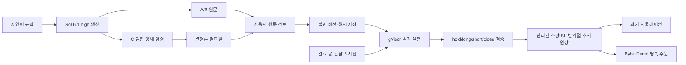

# 생성 전략의 언어·생성 방식 비교 기준

[ADR-046](../adr/046-generated-strategy-language-evaluation.md)에 따라 제품 언어를 평가 전에
승자로 정하지 않는다. 아래는 확인된 구현·관측과 설계 가설을 구분한 런타임 보고서다.
생성 품질·효율 비교와 최종 선택은 동결한 산출물의 별도 평가를 따른다. 여기에는 생성
점수나 승자를 기록하지 않는다. 수익률은 생성 정확도의 대체 지표가 아니다.

## 세 언어의 실제 실행 경로

| 언어 | 현재 실행 | 활용 가능한 특성 | 검증해야 하는 비용·한계 |
| --- | --- | --- | --- |
| Python | CPython에서 원문 `on_bar(ctx, state)` 실행 | 기존 FastAPI·공통 원장과 같은 언어, 이미지에 NumPy·pandas 포함 | 동적 타입·지표 seed·NA·상태 처리 오류, 의존성 이미지 운영 |
| TypeScript | strict 검사 후 JavaScript를 Node에서 실행 | 컴파일 진단을 공개 오류 수정에 활용 가능 | 타입은 실행 시 제거됨. strict 성공이 의미 정확도나 격리를 보증하지 않음 |
| Pine Script | 자체 `pine_v2`가 원문 해석 후 entry/close 의도 전달 | 기존 Pine 입력·지표 계산과 연결 | 지원 문법·지표 범위와 초기 파싱 비용, TradingView 전체 동등성 없음 |

Python의 표·시계열 분석 생태계는 [pandas 공식 소개](https://pandas.pydata.org/docs/getting_started/)와
[NumPy 시작 안내](https://numpy.org/doc/stable/user/quickstart.html)에 근거한다. 이것이 생성
정확도나 수익 우월성의 증거는 아니다. TypeScript의
[타입 제거](https://www.typescriptlang.org/docs/handbook/2/basic-types.html#erased-types)와
[strict 검사](https://www.typescriptlang.org/tsconfig/strict.html)는 별개 계약이다.
TradingView의 [전략 문서](https://www.tradingview.com/pine-script-docs/concepts/strategies/)는
자체 broker emulator와 OHLC 경로 가정을 설명한다. QuantBridge의 공통 broker와 같은
엔진이라는 뜻이 아니다.

## 구현으로 확인한 실행 범위

| 사실 | 코드 근거 | 해석 범위 |
| --- | --- | --- |
| Python 원문 실행·TypeScript strict→JavaScript 실행 | [공통 transport](../../apps/api/src/strategy/code_runtime/sandbox.py#L23), [Node 진입점](../../infra/code-runner/main.cjs#L15) | 문자열 코드 평가를 호스트로 우회하지 않는다. Python/Node의 언어 기능과 프로토콜을 평가한다 |
| Pine 원문은 자체 해석기를 gVisor 안에서 실행 | [Pine transport](../../apps/api/src/strategy/code_runtime/pine.py#L25), [worker](../../apps/api/src/strategy/code_runtime/pine_worker.py) | TradingView 서비스나 별도 외부 Pine 엔진을 실행한 결과가 아니다 |
| 세 경로 모두 동일한 의도·공통 broker 사용 | [백테스트 진입점](../../apps/api/src/strategy/code_runtime/backtest.py#L122), [의도 검증](../../apps/api/src/strategy/code_runtime/models.py) | 독립 외부 프레임워크의 수익률 비교가 아니다. 언어와 엔진을 혼동하지 않는다 |
| 현재 완료봉을 포함한 history·관찰 포지션을 입력 | [격리 SDK](../../infra/code-runner/README.md), [입력 재생](../../apps/api/src/strategy/code_live_replay.py#L37) | OHLCV·수량은 decimal 문자열이다. 언어 내부 float/Number 계산이 Decimal 정밀도를 보장하지 않는다 |

Python 외부 라이브러리는 보존 이미지의 NumPy·pandas, TypeScript 외부 패키지는 없음으로
고정한다. Node 버전은 `mise.toml`, tsc 버전은 FE lock에서 읽는다([빌드](../../infra/code-runner/build.sh)).
표준 라이브러리·내장 모듈의 존재는 호스트 자원 접근 허가를 뜻하지 않는다. 격리는 OS 경계가
집행하며 Python/Node 내부를 제한 언어로 바꿨다고 주장하지 않는다.

지표의 seed·NA·현재봉 포함 여부·warmup은 공통 계약을 따른다. NumPy·pandas나 다른
프레임워크의 기본 EMA/RSI 값이 같은 규칙이라고 추정하지 않는다. 외부 backtesting.py,
backtrader, LEAN을 제품 엔진으로 추가한 비교는 수행하지 않았다. Node에서 실행되는 언어는
생성 TypeScript를 컴파일한 JavaScript이며, 순수 JavaScript 생성 arm을 별도 측정한 것이 아니다.

## 실제 관측과 아직 없는 증거

세 언어의 gVisor native 실행 경로와 보존 이미지 ID는 파일럿 manifest에 고정했다.
각 언어의 `trials/A/{language}/D01/0/trial.json`에는 실제 공개 실행 통과가 남아 있다.
이는 컨테이너에서 실제 소스를 실행한 관측이며, 모든 전략·의도가 의미상
정확하거나 어느 언어가 빠르다는 결론은 아니다. 생성 결과의 점수와 런타임 적합성은 별개다.

별도의 제품 통합 검사는 Python 원문 저장→불변 버전/해시→gVisor 의도→실제 슬롯 11 SQL
체크포인트→영속 리스크/outbox→fake Bybit→ACK 유실 재시작을 같은 세션에서 확인했다
([검사 코드](../../apps/api/tests/trading/test_code_product_journey.py#L144)).
최신 실행 증거는 head `383d9885`, `1 passed, 1 deselected`(6.14초)이며
제품 컨테이너 6개를 **순차** 생성해 최대 동시 1개, 종료 후 전부 수거했다.
보존 Python 이미지 ID는
`sha256:b55d403d3ca3e7816fa65c2f3868622e555678396af7ee25b7b95ed1b0bd9c31`이다.
이미지·동결 소스 변경, 실거래소 주문, Celery 호출은 모두 0이었다.
이 SQL 제품 여정을 세 언어 각각에서 반복 검증한 것으로 확대하지 않는다.

fake 검사는 진입·종결 체결 VWAP 기준 고정 R·SL/추적 보호 파라미터 ACK·절반 TP·명시 close·
반전·재시작 멱등성을 검증했다. **거래소 native SL/추적이 생성한 child 주문의 실제 체결과
정확한 세션/세대 귀속은 관측하지 않았다.** 로컬 청산 주문으로 설명되지 않는 flat은
미정산 marker로 남겨 같은 계정 및 알려진 UID 형제의 새 진입을 막는다. 기존 청산·취소·
보호 복구는 통과한다. 추정 `ExchangeExit` 귀속을 확정 체결이나 PnL 0으로 승격하지 않는다.
응답의 `pnl_complete=false`와 알려진 주문 손익 소계를 구분한다
([리스크 계약](../domain/code-risk-execution.md#native-청산-미정산과-손익-표시)).

광역 CI 관측은 `d18aba62`의 BE `6738 passed, 70 skipped, 2 xfailed`까지다.
후속 미정산·계정 가드 개선의 로컬 SQL 회귀 통과는 이 광역 CI의 포함 범위가 아니며,
통합 head의 재CI가 필요하다. 해당 CI 통과도 실거래소 주문·native child 회계 검증을 대신하지 않는다.
원시 관측 근거는 control의 `runs/sol-strategy-lab/native-product-journey-latest.json`과
`ci-backend-d18aba62.log`에 보존한다.

## 실행 기한과 제품 적합성 판단

백테스트 transport 기본 전체 기한은 최대 900초, live는 **입력 전체 재생마다 30초**다
([transport](../../apps/api/src/strategy/python_runtime/sandbox.py#L82),
[live 재생](../../apps/api/src/strategy/code_live_replay.py#L58)).
TypeScript 컴파일도 같은 전체 기한에 포함하며 별도 컴파일 제한은 60초다. live에서는
전체 30초가 먼저 적용된다. Pine의 초기 import·coverage·콜드 parse와 Python/TS 기동 비용도
기한에서 빠지지 않는다. 따라서 백테스트 실행 성공만으로 live 30초 적합성을 인정하지 않는다.
저장된 입력을 매 평가마다 재생하므로 긴 세션의 지연·메모리 증가는 별도 확인 대상이다.
Pine 콜드 parse를 포함한 언어별 p50/p95나 운영 비용 우열은 이 제품 여정에서 측정하지 않았다.

[가정] Python은 기존 BE와 계산 생태계를 공유하는 유지보수 이점, TypeScript는 공개 컴파일
진단을 B 수정에 활용하는 이점, Pine은 기존 사용자 입력·지표를 유지하는 이점이 있을 수 있다.
[확인 필요] 이 가정이 생성 의미 정확도·수정 성공률·콜드/반복 지연·이미지 운영 부담의
실제 차이로 이어지는지는 별도 결과로 검증해야 한다. strict 통과는 실행 의미·지표 정확도·
자원 안전 보장이 아니며, pandas 기본 지표나 Pine 지원 범위도 자동으로 동등하지 않다.

워크트리 검증은 격리 슬롯 SQL과 직접 service/task 함수, fake provider만 사용한다.
공유 worker가 main 소스를 실행하는 Celery 경유 검증은 금지한다
([워크트리 계약](../development/worktree-parallel.md)). 실인증 Bybit Demo 주문 관측과 배포는
별도 범위이며 이 보고서의 완료 증거가 아니다.
연구 생성은 인증된 Codex CLI의 `gpt-6.1-sol/high`로 수행했고, 제품 OpenAI API 생성기
연결의 기존 키 재사용/새 키 선택은 사용자 답변 대기이며 기존 수동 저장 UI·native 런타임과는 별개다.

## 생성 방식별 검증 질문

| 방식 | 실제 과정 | 장점 가설 | 반증 조건 |
| --- | --- | --- | --- |
| A 직접 생성 | 자연어 → Sol 원문 1회 → 격리 실행 | 자유로운 상태·패턴 표현 | 실행 가능해도 진입·무효화 의미가 다르면 실패 |
| B 공개 오류 수정 | 자연어 → Sol 원문 → 공개 검사 → 최대 2회 수정 | 타입·프로토콜 오류를 자동 수정 | 비공개 의미 정답을 피드백하거나 예산 초과를 숨기면 비교 무효 |
| C 명세 컴파일 | 자연어 → Sol 닫힌 StrategySpec → 검증 → 결정론 컴파일 | 코드 형태와 공통 계약의 변동 감소 | 명세로 표현 못 하는 전략을 다른 규칙으로 바꾸면 실패 |

현재 C의 닫힌 compiler는 30종 중 22종을 표현한다([구현](../../apps/api/src/strategy/code_runtime/compiler.py)). 나머지 8종도 전체 분모에 남긴다.
각 언어별 C 생성 요청은 독립 실행한다. 하나의 명세에서 여러 언어로 내보낸 개발 fixture는
독립 모델 생성 횟수나 생성 성능으로 세지 않는다.

## 공통 신뢰 경계

생성 코드는 API 키·DB·주문 권한을 갖지 않는다. Python·Node·Pine 모두 network none,
read-only, nonroot, CPU·메모리·PID·시간·출력 제한을 적용한다. gVisor는
[방어 계층](https://gvisor.dev/docs/architecture_guide/security/)이며 무조건적인 안전 보장이
아니다. Node의 [vm 자체도 보안 경계가 아니다](https://nodejs.org/api/vm.html).

제품 기반은 세 언어를 수동 저장·백테스트·데모 세션에 연결할 수 있도록 공통화한다.
이는 특정 언어를 권장하거나 LLM 생성 결과를 검토 없이 저장하는 결정과 다르다.
생성 기능의 기본 경로·추천 언어는 최종 품질 비교 후 정한다.

## 비교 결과를 해석할 때의 한계

의미 정답은 compiler 출력이 아닌 별도 식이며 원장 비교는 **독립 신호 + 공유 broker**다.
초기 R·수량 보존은 별도 Decimal 계산으로 검사한다. 이 범위를 거래소 실체결의 독립
재현으로 확장하지 않는다. 4개 의도 중 관찰 기회가 없으면 미검증이며 0점이다.
반복 생성은 같은 전략의 상관 표본이므로 전략 평균을 먼저 비교한다.

과거 24개월·실행 분봉 6개월은 회고 자료다. 실제 과거 펀딩 시각·비율을 사용해도 가격은
OHLC 시가 proxy다. Bybit의 공식
[선형 계약 펀딩 계산](https://www.bybit.com/en/help-center/article/Funding-fee-calculation/)은
mark price를 사용하므로 실제 펀딩 금액과 같다고 주장하지 않는다. 정산 주기는 동적으로
달라질 수 있어 관측된 정산만으로 누락이 없다고 확정하지 않는다.
CLI 구독의 실제 USD 비용은 알 수 없다. 출력 토큰·생성 시간은 예산 효율 proxy로 보고한다.
