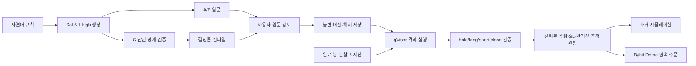

# 생성 전략의 언어·생성 방식 비교 기준

[ADR-046](../adr/046-generated-strategy-language-evaluation.md)에 따라 제품 언어를 평가 전에
승자로 정하지 않는다. 아래는 확인된 구현과 설계 가설이며, 최종 순위는 동결한 실제 생성
산출물의 의미 점수로 결정한다. 수익률은 생성 정확도의 대체 지표가 아니다.

## 세 언어의 실제 실행 경로

| 언어 | 현재 실행 | 활용 가능한 특성 | 검증해야 하는 비용·한계 |
| --- | --- | --- | --- |
| Python | CPython에서 원문 `on_bar(ctx, state)` 실행 | 기존 FastAPI·공통 원장과 같은 언어, 이미지에 NumPy·pandas 포함 | 동적 타입·지표 seed·NA·상태 처리 오류, 의존성 이미지 운영 |
| TypeScript | strict 검사 후 JavaScript를 Node에서 실행 | 컴파일 진단을 공개 오류 수정에 활용 가능 | 타입은 실행 시 제거됨. strict 성공이 의미 정확도나 격리를 보증하지 않음 |
| Pine Script | 자체 `pine_v2`가 원문 해석 후 entry/close 의도 전달 | 기존 Pine 입력·지표 계산과 연결 | 지원 문법·지표 범위와 초기 파싱 비용, TradingView 전체 동등성 없음 |

Python의 표·시계열 분석 생태계는 [pandas 공식 소개](https://pandas.pydata.org/docs/getting_started/)와
[NumPy 시작 안내](https://numpy.org/doc/stable/user/quickstart.html)에 근거한다. 이것이 생성
정확도나 수익 우월성의 증거는 아니다. TypeScript의
[타입 제거](https://www.typescriptlang.org/docs/handbook/2/basic-types.html#erased-types)와
[strict 검사](https://www.typescriptlang.org/tsconfig/strict.html)는 별개 계약이다.
TradingView의 [전략 문서](https://www.tradingview.com/pine-script-docs/concepts/strategies/)는
자체 broker emulator와 OHLC 경로 가정을 설명한다. QuantBridge의 공통 broker와 같은
엔진이라는 뜻이 아니다.

## 생성 방식별 검증 질문

| 방식 | 실제 과정 | 장점 가설 | 반증 조건 |
| --- | --- | --- | --- |
| A 직접 생성 | 자연어 → Sol 원문 1회 → 격리 실행 | 자유로운 상태·패턴 표현 | 실행 가능해도 진입·무효화 의미가 다르면 실패 |
| B 공개 오류 수정 | 자연어 → Sol 원문 → 공개 검사 → 최대 2회 수정 | 타입·프로토콜 오류를 자동 수정 | 비공개 의미 정답을 피드백하거나 예산 초과를 숨기면 비교 무효 |
| C 명세 컴파일 | 자연어 → Sol 닫힌 StrategySpec → 검증 → 결정론 컴파일 | 코드 형태와 공통 계약의 변동 감소 | 명세로 표현 못 하는 전략을 다른 규칙으로 바꾸면 실패 |

현재 C의 닫힌 compiler는 30종 중 22종을 표현한다. 나머지 8종도 전체 분모에 남긴다.
각 언어별 C 생성 요청은 독립 실행한다. 하나의 명세에서 여러 언어로 내보낸 개발 fixture는
독립 모델 생성 횟수나 생성 성능으로 세지 않는다.

## 공통 신뢰 경계

생성 코드는 API 키·DB·주문 권한을 갖지 않는다. Python·Node·Pine 모두 network none,
read-only, nonroot, CPU·메모리·PID·시간·출력 제한을 적용한다. gVisor는
[방어 계층](https://gvisor.dev/docs/architecture_guide/security/)이며 무조건적인 안전 보장이
아니다. Node의 [vm 자체도 보안 경계가 아니다](https://nodejs.org/api/vm.html).

제품 기반은 세 언어를 수동 저장·백테스트·데모 세션에 연결할 수 있도록 공통화한다.
이는 특정 언어를 권장하거나 LLM 생성 결과를 검토 없이 저장하는 결정과 다르다.
생성 기능의 기본 경로·추천 언어는 최종 품질 비교 후 정한다.

## 비교 결과를 해석할 때의 한계

의미 정답은 compiler 출력이 아닌 별도 식이며 원장 비교는 **독립 신호 + 공유 broker**다.
초기 R·수량 보존은 별도 Decimal 계산으로 검사한다. 이 범위를 거래소 실체결의 독립
재현으로 확장하지 않는다. 4개 의도 중 관찰 기회가 없으면 미검증이며 0점이다.
반복 생성은 같은 전략의 상관 표본이므로 전략 평균을 먼저 비교한다.

과거 24개월·실행 분봉 6개월은 회고 자료다. 실제 과거 펀딩 시각·비율을 사용해도 가격은
OHLC 시가 proxy다. Bybit의 공식
[선형 계약 펀딩 계산](https://www.bybit.com/en/help-center/article/Funding-fee-calculation/)은
mark price를 사용하므로 실제 펀딩 금액과 같다고 주장하지 않는다. 정산 주기는 동적으로
달라질 수 있어 관측된 정산만으로 누락이 없다고 확정하지 않는다.
CLI 구독의 실제 USD 비용은 알 수 없다. 출력 토큰·생성 시간은 예산 효율 proxy로 보고한다.
