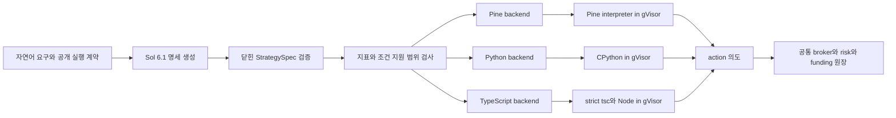

# C 경로: 타입 명세를 검증하고 세 언어로 컴파일한다

이 문서는 [ADR-046](../adr/046-generated-strategy-language-evaluation.md)의 경쟁 경로 C를
정의한다. 기대 효익은 **설계 가설**이며 생성 정확도·수익률·실험 순위를 뜻하지 않는다.
방식과 언어의 최종 선택은 별도의 실측 평가가 결정한다.

## 입력과 출력 경계

LLM은 [StrategySpec](../../apps/api/src/strategy/code_runtime/spec.py)의 JSON만 생성한다.
지표·비교 연산·조건·상태 패턴은 닫힌 registry에 속해야 한다. 임의 소스 문자열이나
외부 함수를 명세에서 실행하지 않는다. 지원하지 않는 표현은 명시적으로 거부하며 다른
단순 전략으로 대체하지 않는다. 카탈로그의 개발용 참조 명세를 LLM의 정답인 것처럼
실험에 주입하지 않는다.

[컴파일러](../../apps/api/src/strategy/code_runtime/compiler.py)의 공개 함수는
`compile_strategy(spec, language) -> source_string`이다. 같은 명세의 Pine·Python·TypeScript
출력을 생성하되 각 언어 코드를 실제 런타임에서 실행한다. 명세 자체가 봉을 실행하는
네 번째 런타임이 되지 않는다. 동일 컴파일 결과만으로 자연어 요구의 충족을 입증하지도 않는다.

실행기는 완료된 현재 봉을 포함하는 history, bar, 확정 position, 고정 params와 로컬 state를
받는다. Python은 `on_bar(ctx, state)`, TypeScript는 `onBar(ctx, state)`, Pine은 제한된
`strategy.entry`·`strategy.close` 의도를 사용한다. 반환 권한은 `hold/long/short/close`뿐이다.
수량·SL·부분 익절·트레일링·체결·수수료·펀딩·이익을 코드가 선언해 원장에 덮어쓰지 못한다.

## 수식과 오류

지표 seed, 최초 유효 봉, NA, 교차의 이전/현재 포함 여부, 동률 처리는 공개 실행 계약에
속한다. 라이브러리 기본값에 맡기지 않는다. 예를 들어 현재 계약의 EMA는 첫 n개 SMA로
seed하고 이후 `2/(n+1)`을 사용한다. RSI는 첫 n개 변화의 Wilder 평균을 사용하며
하락 평균 0의 결과 100은 명시적인 프로젝트 규약이다. TradingView 전체 의미와 같다는
주장은 아니다. 과거 봉·확정 상위 봉만 읽고 HA 합성 가격을 실제 체결 가격으로 쓰지 않는다.

수치 계약 v2의 유한 비교는 `epsilon=1e-12*max(1,abs(a),abs(b))` 안을 동률로 취급한다.
strict 비교는 이 band 밖에서만 참이며 교차의 이전·현재 비교에도 같은 규칙을 쓴다.
원시 OHLC 극값 선택, Aroon 극값 동률, 정수·시각, 지표 내부 가격 변화 부호와 분모 0은
exact로 유지한다. 작은 양수 분모를 임의로 0이나 NA로 바꾸지 않는다.

생성 Python·TypeScript의 평균은 기준값에서 차이를 합산하고 EMA/RMA는
`previous+alpha*(source-previous)`로 갱신한다. 생성 Pine은 stdlib 전역을 바꾸지 않고
지표별 갱신과 상수 창 guard를 쓴다. guard는 n개 입력이 모두 유한할 때만 평균을 상수로,
std를 0으로 보존하며 CCI·회귀의 상수 MAD·기울기도 0을 유지한다. 최근 n개 입력이 같다는
이유로 과거 EMA 상태를 현재 상수에 즉시 붙이지 않는다. 이 계약은 새 manifest에 동결한다.

검증 실패·미지원 registry·컴파일 오류·격리 실행 오류는 서로 구분해 보존한다. 자동 수정이
허용되는 실험에서는 외부 manifest의 횟수·토큰·시간 한도를 따른다. 실행 중 LLM 호출이나
봉마다의 재생성은 없다. 이미지·gVisor 부재를 호스트 실행으로 우회하지 않는다.

## 검증과 운영 연결

생성 성공률과 의미 충실도는 방법 A/B/C와 실행 언어를 분리해 평가한다. 개발 fixture와 평가
fixture를 구분하고, 공개 카탈로그를 지원한다는 사실을 미지 전략 전반의 일반화 증거로
부풀리지 않는다. 의미 정답은 compiler 출력이 아닌 별도 수식과 손계산 예제로 확인하며
평가 산출물에는 검증 범위와 저자 독립성의 한계도 적는다.

제품 저장·비동기 백테스트·라이브 재생은
[code_v1 저장 계약](../development/code-strategy-storage.md)을 따른다. 소스와 명세·컴파일러·
모델·실행 이미지·설정의 근거를 함께 고정해야 재현성을 평가할 수 있다. 라이브 재시작은
현재 position을 과거에 주입하지 않고 관찰한 봉별 입력을 재생한다. 실제 주문 보호와
재시도·반전의 권위는 trading 원장에 있다.

## 가설과 검증할 대가

| 설계 가설 | 검증할 증거와 대가 |
| --- | --- |
| 닫힌 명세가 불법 조합을 일찍 드러낸다 | 자연어를 잘못 해석한 유효 명세도 가능하다. 독립 의미 판정이 필요하다. |
| 한 명세를 세 언어에 일관되게 적용할 수 있다 | backend 세 개의 seed·NA·float·상태 의미가 갈라질 수 있어 언어별 실행 검증이 필요하다. |
| 자유 코드보다 검토와 오류 분류가 쉬워질 수 있다 | 명세·registry 설계와 compiler 유지 비용이 생기며 표현 범위를 제한한다. |
| 반복 실행의 결정성을 관리하기 쉬워질 수 있다 | 동일 구현의 체계적 오류까지 반복할 수 있다. hash 일치만으로 정답을 입증하지 않는다. |

registry 확장, 세 backend의 검증, 타입 SDK, 격리 이미지, 공통 원장과 재시작 보호는 고정
운영 비용이다. 이를 제외한 LLM 생성 시간만으로 전체 비용 우위를 단정하지 않는다.
수익은 관측 시세·가격 proxy·비용 가정에 따른 별도 회고 결과이며 방법 품질 점수로 합치지 않는다.

## 회고 경제 검증의 시간봉 적용 범위

`sol_economics.py`는 카탈로그 ID별 닫힌 지원표를 사용하며 생성 소스에서 시간봉을 추측하지
않는다. case 21의 UTC 일중 VWAP은 1h·4h, case 30의 1h EMA9/21과 직전 완료 4h regime은
1h 부모 신호봉에만 적용한다. 다른 case는 현재 경제 매트릭스의 1h·4h·1d를 허용한다.
이는 선택한 첫 semantic pass 원문을 다른 시간봉 전략으로 재해석하지 않기 위한 경계다.

[공식 VWAP 설명](https://www.tradingview.com/support/solutions/43000502018-volume-weighted-average-price-vwap/)은
한 anchor 기간 안에 여러 봉이 있어야 하며 Session anchor와 1D 봉의 조합은 매봉 reset되어
유용하지 않다고 명시한다. UTC 일중 reset의 1d 제외는 이 제약을 적용한 프로젝트 판단이다.
지원하지 않는 조합과 분봉 없는 24개월 일봉의 펀딩 배분은 이유가 있는 N/A로 보존하고
native 실행을 호출하지 않는다. case별 48개 계획 셀과 실패·미지원 분모는 줄이지 않는다.

품질 보고서의 semantic 관찰은 초기 요구 hash와 실제 실행 source SHA256을 함께 검증한다.
source hash가 없는 과거 관찰에 현재 소스의 hash를 사후 부착해 인증하지 않는다. 경제 선정은
완료된 1,350개 품질 행, manifest·입력 proof, 해당 조합의 실제 semantic pass 반복 목록과
첫 pass의 source SHA256을 보고서에 대조한다. 선정 JSON 안의 자체 선언만으로 다른 반복이나
소스를 품질 통과 산출물로 바꿀 수 없다.

생성 호출 중 토큰 usage 미보고가 하나라도 있으면 해당 artifact의 토큰 효율 성분은 0점이다.
미확인 소비량을 측정 0으로 취급해 보상하지 않으며, 관측된 생성 시간의 효율 성분은 별도로
유지한다. 이 수식 변경은 새 실험 manifest에 동결하고 과거 결과와 섞지 않는다.
