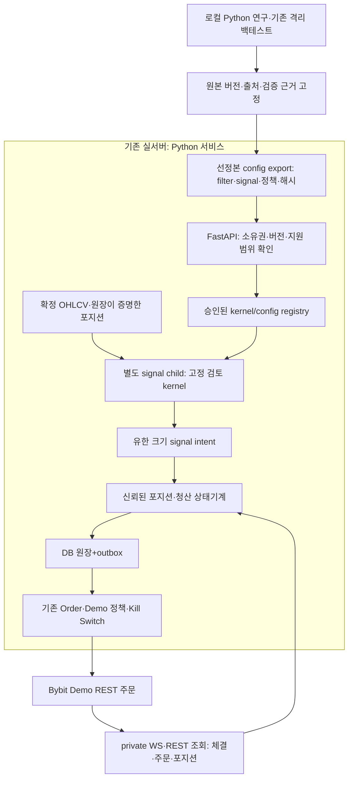
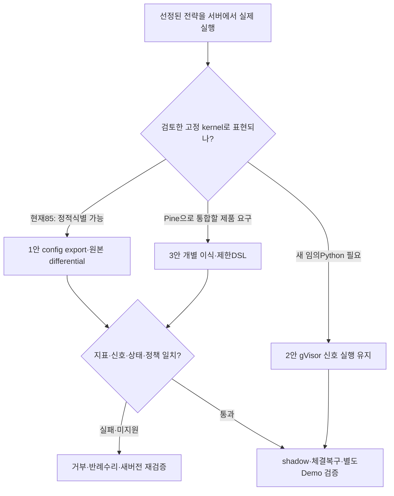

# Python 연구 전략의 서비스 실행 방법 비교

**제안: 현재 선정된 85개 정의에는 검토한 공통 Python 계산 코드와 설정만 배포하는 방식을 먼저 검증한다.**
임의 Python 연구는 기존 gVisor 경계를 유지한다. Pine으로 이식할 필요가 있는 전략은 개별 의미 검증을 거친다.
이는 설계 제안이며 ADR-045를 변경하거나 Python 자동매매를 활성화한 결정이 아니다.

조사일은 2026-10-21, 코드 기준은 `6bc8738d`(#915·#917 포함)다. **확인**은 코드·공식 문서·정적 검사의
관측, **[가정]**은 설계 평가·비용 추정, **[확인 필요]**는 후속 실험이다. 최신 운영 상태를 직접 조회하지 않았으며
`docs/status.md`에 기록된 배포 사실과 이번 조사의 실행 증거를 구분한다.
호스트 용량은 이전 관측의 ARM64 2CPU·약12GiB를 계획 기준으로 사용하며, 이번 조사에서 재측정하지 않았다.

## 1. 목표와 현재 구조

목표는 Python으로 지표·전략을 연구하고 로컬 백테스트한 뒤, 선정 전략을 **서비스에서 새 봉마다 실제 계산**해
Bybit Demo 주문 관리에 연결하는 것이다. 결과 조회·등록만 제공하는 방식은 이 목표의 완료가 아니다.
임의의 웹 Python을 상시 실행해야 한다는 요구와, 선정한 전략만 계속 실행한다는 요구도 구분한다.

| 층 | 현재 확인한 구현 | 이번 제안과의 관계 |
| --- | --- | --- |
| 앱·데이터 | FastAPI·PostgreSQL/TimescaleDB·Redis·Celery·Next.js. 공유 ARM64 호스트의 자원 제약이 있음 | 언어를 새로 Python으로 바꾸는 일이 아니다. 이미 Python인 서버에서 **어떤 코드를 어떤 권한으로 실행하는지**의 문제다. |
| Pine | 자체 `pine_v2` 인터프리터, 백테스트·Optimizer·Stress Test, 별도 신호→outbox→Order→Bybit Demo 경로 | TradingView 서버에 코드를 맡기는 구조가 아니다. 지원 의미·자원·라이브 정합성 검증은 우리 책임이다. |
| Python 연구 | 별도 전략/불변 버전/백테스트 원장, HTTP gateway→gVisor 신호 child→신뢰된 체결·비용 계산 | 서버 runner 준비와 Python live 연결은 별도 미완이다. 원장 테이블 존재가 실행 가능 증거는 아니다. |
| 청산 | `swing_risk.py`의 고정 R·50% 익절·본절 트레일링·generation 및 연구용 1분봉 adapter | 계산 기반은 존재한다. 실제 부분체결·취소 경합·복구를 연결하는 live adapter는 별도다. |
| 작업 상태 | 기존 작업 트리에 미커밋 registration/execution-policy 변경이 있음 | 이 보고서가 완료된 main 기능으로 간주하지 않는다. 조사·스킬은 최신 main의 별도 브랜치에서 정리했다. |

구현 정본은 [Pine 실행 구조](../architecture/pine-execution-architecture.md),
[Python 연구 계약](python-strategy-research.md), [ADR-045](../adr/045-python-strategy-research.md)다.
현 제품은 **Bybit Demo 전용**이며 mainnet·다중 거래소로 범위를 넓히지 않는다.

## 2. 세 스킬·세 에이전트로 조사한 범위

사용자가 요청한 `find-skills`로 후보를 검색한 뒤, 세 패키지의 지침·출처·라이선스를 검토해
[프로젝트 스킬](../../.agents/skills/README.md)로 고정했다. 설치 수와 GitHub 별표는 발견용 지표이며 근거의 질 점수가 아니다.

| 담당 스킬 | 실제 작업 | 결론에 기여한 부분 |
| --- | --- | --- |
| [insane-search](../../.agents/skills/insane-search/SKILL.md) | 공식 문서·공식 GitHub API 조사, Wasmtime 문서 실제 수집, AST 무실행 변환 예시, 선정 소스 census | 컴파일≠격리, 제한 변환의 표현 범위, 공통 kernel+config 가능성 |
| [notebooklm](../../.agents/skills/notebooklm/SKILL.md) | 공식 출처16개 import/ready 확인, 출처를 지정한 질의3개 실행·인용 대조 | 전략/포지션/주문 책임 분리, Bybit 제약, 체결·재시작 연결 |
| [scientific-critical-thinking](../../.agents/skills/scientific-critical-thinking/SKILL.md) | 원문 논문·공식 문서로 주장별 증거, 과최적화·누출·체결 모형·반증 실험 검토 | 수익·회계 일치·동등성·코드 안전·운영 적격성을 별도로 판정 |

스킬 provenance·고정 커밋·파일 해시는 [잠금 파일](../../.agents/skills/research-skills.lock.json)에 있다.
`insane-search`의 별표·마켓플레이스 설정 권유는 제거했고 자동 의존성 설치·유료 검색·브라우저 우회는 사용하지 않았다.
외부 조사 도구에는 공개 공식 자료만 전달한다. 앱 의존성·서버·DB·거래 주문은 변경하지 않았다.
NotebookLM은 이전 호스트를 사용한 CLI `0.7.3`의 인증 오류를 해당 프로젝트의 PyPI `0.8.5` 업데이트로 해소했다.
기존 Playwright `1.61.0`은 유지했고 앱 의존성은 변경하지 않았다.
[조사 노트북](https://notebook.google.com/notebook/81c377dc-3b9c-4042-9d4d-0fa64cc8ca62)은 비공개 상태다.
세 답변의 source UUID·URL 인용을 직접 문서와 대조했다. 모델의 보안·속도·주문 수용 보장과
옛 generation의 실제 fill을 현재 exposure에 반영하지 않아도 된다는 오독은 채택하지 않았다.

스킬의 방법론 출처는 Kassis 외(2026), [Scientific Agent Skills](https://arxiv.org/abs/2609.00065),
[DOI](https://doi.org/10.48550/arXiv.2609.00065)다. 이 논문은 task-level 효과 검증을 제시하지 않으므로
스킬을 썼다는 사실을 조사 결론의 정확성 증거로 사용하지 않는다.

## 3. 직접 확인한 중요한 차이: 현재 후보는 임의 Python 100종이 아니다

`tools/research/catalogue.py`의 필터 10종×진입 신호 10종이 같은 `strategy_template.py.txt`를 사용한다.
영상 원본 100개 재현물이 아닌 프로젝트의 연구 가설 100개다.
source 정책과 swing 정책의 생성 규칙을 AST·문자열·해시로 대조했다. 사용자 전략 소스의 실행·표현식 평가는 하지 않았다.

| 정적 검사 | 관측 |
| --- | --- |
| 전체 후보 | 100가설, source/swing 정책별 200소스, 200개 고유 해시·AST 파싱 |
| 기존 선정 집합 | source 46+swing 39=85개 정책 포함 정의, 서로 다른 가설은 56개 |
| 설정으로 원본 식별 | **85/85 일치, unknown 0**. 필터·신호·정책·warmup·params와 원본 해시 대조 |
| 변경/미지원 검사 | 알 수 없는 ID·정책, 소스 변조, params/warmup 변경의 5종 거부 |
| 입증하지 않은 것 | 새 kernel의 계산·백테스트·live 동등성, 코드 안전성, 수익 지속. 새 실행 kernel은 아직 구현하지 않음 |

따라서 현재 집합은 **Python 전체를 번역하기보다, 검토한 계산 kernel 하나에 설정을 전달하는 경로**를 먼저 시험할 수 있다.
이 kernel은 기존 수식을 보존해야 한다. 원본 EMA는 매봉 잘린 **201봉 창의 첫 값으로 초기화**하고 다시 계산한다.
현재 Pine EMA의 SMA 초기값·누적 상태로 이름만 치환하면 다른 신호가 될 수 있다.

이 구분은 Python→Pine 의미 보존이 자동으로 성립하지 않는 구체적 반례다.
Pine 자체도 봉·이력·실시간 rollback을 갖는 고유 실행 모형이다.
([Pine 실행 모형](https://www.tradingview.com/pine-script-docs/language/execution-model/))

## 4. 브레인스토밍: 변환 방법을 펼쳐 비교한 결과

### 실행 형식만 바꾸는 후보

| 방법 | 가능한 일 | 보안·호환 판정 |
| --- | --- | --- |
| `.pyc` | Python bytecode 캐시 생성 | 권한 축소 없음. 보안 대안으로 제외. [CPython](https://docs.python.org/3/library/py_compile.html) |
| Cython·Nuitka·native | C extension/실행파일·배포 최적화 | 파일·네트워크·native library 권한이 자동 제거되지 않는다. 속도/패키징 용도는 가능. [Cython](https://docs.cython.org/en/latest/src/quickstart/overview.html), [Nuitka](https://nuitka.net/pages/overview.html) |
| Python→WASI CPython+Wasmtime | 제한 host imports·memory sandbox에서 Python interpreter 실행 | 실제 격리 후보. Linux wheel·Pyodide wheel이 그대로 맞지 않으며 NumPy/pandas·성능 검증 필요. [CPython WASI](https://github.com/python/cpython/blob/main/Platforms/WASI/README.md), [Wasmtime](https://docs.wasmtime.dev/security.html) |
| Pyodide | 브라우저/Node용 Python, 포팅된 NumPy/pandas | JS FFI·기본 `globalThis`로 host API가 노출될 수 있다. WASM이라는 이유만으로 독립 보안 경계라고 부를 수 없다. [개요](https://pyodide.org/en/stable/project/about.html), [JS API](https://pyodide.org/en/stable/usage/api/js-api.html) |

### 실행 의미·입력을 좁히는 후보

| 방법 | 가능한 일 | 비용·한계 |
| --- | --- | --- |
| 고정 검토 Python kernel+설정 | 현재 필터/진입 조합·정책 ID를 실행. 새 사용자 소스는 실행하지 않음 | 현재 85개 정적 식별 가능. 새 지표 코드는 리뷰·테스트·PR·이미지 버전으로 추가 |
| 제한 Python AST→새 JSON IR | 허용한 지표·조건·유한 상태만 data로 표현 | 임의 Python 변환이 아닌 새 제한 언어. compiler와 계산 엔진을 함께 만들면 구현 면적 증가 |
| 선정 전략 이식/제한 DSL→Pine | 결정론적으로 생성한 Pine을 기존 parser·coverage·실행 경로로 전달 | 새 IR 엔진보다 재사용 유리. seed·NA·warmup·상태·체결 의미 비교 필수 |
| 기존 gVisor Python 유지 | 고정 라이브러리 범위 내 Python 표현력을 유지하고 신호만 반환 | 별도 실행 환경·자원·상태 복구 운영 필요. 의미 변환을 강제하지 않는 장점 |

RestrictedPython이나 `import` 금지 검사만으로 sandbox가 성립하지 않는다.
공식 프로젝트도 이를 sandbox로 규정하지 않는다. AST 파서도 큰/복잡한 입력에 의한 자원 고갈·crash 가능성이 있어
변환 단계에 길이·깊이·노드 수·CPU/메모리 한도를 둔다.
([RestrictedPython](https://restrictedpython.readthedocs.io/en/latest/), [CPython AST 경고](https://docs.python.org/3/library/ast.html))

WASM 경로도 host callback·컴파일 단계·전체 host 메모리까지 guest limit이 해결하지 않는다.
fuel/epoch와 process/cgroup 한도를 함께 설계해야 한다.
([실행 중단](https://docs.wasmtime.dev/examples-interrupting-wasm.html),
[ResourceLimiter 범위](https://docs.rs/wasmtime/latest/wasmtime/trait.ResourceLimiter.html))

## 5. 최종 3안과 전체 점수표

**[가정] 점수는 설계 선호도이며 보안 인증·수익 확률·성능 실측이 아니다.**
공통 5축을 각 0~5로 평가하고 `Σ(점수/5×가중치)`로 합산한다.
0은 경로 없음, 1은 목표와 큰 불일치, 3은 조건부 가능하나 큰 공백, 5는 **정한 범위에서** 가장 직접적인 경로다.
다음 표는 필요한 검증·자원·권한 조건을 구현했을 때의 예상 평가다. **세 안 모두 지금 배포 적격 판정은 아니다.**

| 순위·안 | 목표/표현 25 | 권한·장애 격리 25 | 계산·BT·운영 의미 25 | 재사용/구현 15 | 개인 운영/비용 10 | 합계 |
| --- | ---: | ---: | ---: | ---: | ---: | ---: |
| **1. 선정본 고정 kernel+config** | 5 | 4 | 4.5 | 5 | 4.5 | **91.5/100** |
| **2. 기존 gVisor Python+신뢰된 주문 제어** | 5 | 4 | 4.5 | 5 | 3 | **88.5/100** |
| **3. 선정본/제한 DSL→Pine 재사용** | 3 | 4 | 3 | 5 | 4.5 | **74/100** |

1안의 표현력 5는 **현재 85개 집합**에 한정한다. 임의 Python 지원 점수는 아니다. 1안의 4점 격리는
키·직접 egress가 없는 별도 signal child와 OS 자원 한도·종료·복구 검증을 전제한다.
검토한 내부 코드의 장애 경계이며 악성 임의 Python을 같은 child에서 허용한다는 뜻이 아니다.
2안은 임의 전략 의미를 유지하는 경로가 가장 직접적이지만 runner의 배포·이미지·상태·자원 운영 부담이 있다.
3안은 단순 source 이식부터 시작할 수 있으나 원본 계산을 다른 엔진에 맞추는 검증 비용을 감점했다.
3점 차이를 통계적으로 유의한 우월성처럼 해석하지 않는다. 새 arbitrary Python 지원이 필수가 되면 2안이 우선이다.

점수 전에 적용할 **필수 조건**은 다음과 같다. 수익 점수로 실패를 상쇄하지 않는다.

1. 실제 새 봉 신호 실행·Demo 주문 제어부 연결 경로, 미지원 명시 거부.
2. 원본 식별과 지표·신호·상태 trace 일치, 당시 과거 입력만 제공.
3. 키·주문 권한은 신뢰 제어부만 보유, Demo 정책·Kill Switch·수량/가격 검증 유지.
4. 실제 fill·잔량·취소·generation 영속과 재시작 복구, 중복·초과 주문 방지.
5. timeout/OOM/crash·과대 출력 제한, 버전 고정·관측·롤백. 수익 전략 승격은 별도 미사용 기간 평가.

### 에이전트 의견이 갈린 이유와 통합

| 관점 | 조사에서 우선한 것 | 통합 판단 |
| --- | --- | --- |
| 변환·실행기 | 처음에는 원본 의미 유지와 기존 gVisor 재사용 우선. 85/85 정적 식별 후 현재 집합의 고정 kernel안으로 변경 | 현재 후보에는 범용 번역기가 과하다. kernel+config가 작은 후속 실험 |
| 트레이딩·주문 | 이미 연구한 같은 artifact를 격리 신호 플러그인으로 실행하는 것이 가장 직접적 | 새 임의 Python에는 2안 유지. 어느 언어든 live 체결·복구 adapter가 공통 핵심 |
| 퀀트 비판 검토 | 정적 식별·회계·수익·동등성·안전성은 서로 다른 증거 | 1안의 우위는 현재 집합·내부 신뢰 코드에 한정. 변환/운영 검증 전에 수익 결과만으로 승격 금지 |

**종합 제안은 1안으로 소수 선정본을 먼저 검증하고, 연구의 자유도는 2안에 남기는 구조다.**
100개마다 코드를 배포할 필요는 없다. 검토한 kernel 한 버전에 여러 설정을 등록한다.
범위 밖의 지표는 임의 코드 fallback 대신 미지원 처리하고 새 kernel 버전 또는 기존 gVisor 연구 경로로 보낸다.

## 6. 1안이 실제 서버에서 하는 일



서버는 계속 Python을 사용한다. 사용자/연구 산출물에서 받는 것은 다음처럼 **실행 코드가 없는 설정**이다.
아래는 제안 스키마 예시이며 현재 API 계약이 아니다.

```json
{
  "kernel_version": "frozen_research_v2_201bar",
  "filter_id": "ema_trend",
  "signal_id": "ema_cross",
  "exit_policy": "swing_two_bar_1m",
  "warmup_bars": 200,
  "params": {}
}
```

실제 묶음에는 원본·params·kernel/image·정책·데이터·프로토콜 해시가 추가된다.
ID는 정해진 enum에 대조한다. DB의 문자열을 `eval`하거나 모듈/함수 이름으로 동적 import하지 않는다.
새 지표 함수는 일반 앱 코드처럼 리뷰·테스트·PR·고정 이미지로 추가한다.
`print('ff')`는 출력 제한·로그 정책의 문제일 뿐이다. 현재 격리 runner는 일반 stdout/stderr를 버리며,
무한 루프·메모리·파일·네트워크·잘못된 주문 의도는 각각 다른 경계에서 제한한다.

1안은 추가 VM을 필수로 하지 않는다. **[가정]** 기존 호스트의 별도 signal process와 CPU/RSS/출력/시간 한도로
시작할 수 있다. 실제 한도·동시성은 공유 2CPU 환경에서 측정해야 한다. 무거운 연구 큐와 live 신호의
기한을 분리하며, 현재 default Celery slot을 긴 원격 연구 요청이 점유하는 구조는 별도 개선 대상이다.
임의 Python을 이 경로에 넣는 순간 1안의 전제가 깨진다. ADR-045의 임의 코드 전용 실행기 규칙은 유지한다.

이 책임 분리는 [LEAN의 Alpha→Portfolio/Risk→Execution](https://www.quantconnect.com/docs/v2/writing-algorithms/algorithm-framework/overview),
[Freqtrade의 전략·callback](https://www.freqtrade.io/en/stable/strategy-callbacks/)에서 확인할 수 있다.
프레임워크를 교체하자는 제안은 아니다. 전략이 거래소 키를 가져야 한다는 전제를 피하는 참고 구조다.

## 7. 포지션·반익절·trailing·교체가 가능한가

**가능하되 언어 변환과 별개인 주문 상태 관리가 필요하다.** 방향 `d=+1(long)/-1(short)`, 실제 진입가 E,
직전 완료한 같은 시간봉 두 개의 극값 S에 대해 `R=1.10×d(E-S)>0`으로 고정한다.
SL=`E-dR`, 최초 수량 50% TP=`E+d×1.5R`, trailing 활성=`E+d×2R`, 거리=`2R`이다.
롱 E=100·두 봉 저점=95이면 SL=94.5, R=5.5, TP=108.25, 활성=111, trailing 거리=11이다.
111에서 활성되면 첫 stop은 100이며, 이후 최고가가 114라면 103으로 올라간다. 숏은 대칭이다.

| 요구 | 판정과 남는 작업 |
| --- | --- |
| 롱/숏·명시 청산·SL | 기존 신뢰된 주문 계층으로 가능. 실제 entry 부분체결·VWAP·R 동결 시점·최초 보호 확인 필요 |
| 1.5R에서 최초 수량 50% | 독립 reduceOnly TP 등으로 가능. native Partial TP/SL 한 쌍은 `tpSize=slSize`여서 TP50%+SL100%를 한 쌍으로 표현 불가 |
| 2R 활성·2R 거리 trailing | Bybit `activePrice`+절대 거리 `trailingStop`으로 표현 가능. LTP tick·부착 지연·기존 SL과의 공존을 Demo에서 검증 |
| 계획 교체·반전 | generation으로 새 명령을 제한하고 이전 exit 취소·terminal 확인·late fill을 처리. 취소 ACK만으로 취소 완료로 보지 않음 |
| 재시작·복구·복수 전략 | 원장+거래소 주문/체결/포지션 대조 후 재개. 초기에는 계정/심볼/positionIdx당 한 전략 소유자로 제한하는 것이 단순 |

근거는 [Bybit create](https://bybit-exchange.github.io/docs/v5/order/create-order),
[cancel](https://bybit-exchange.github.io/docs/v5/order/cancel-order),
[trading-stop](https://bybit-exchange.github.io/docs/v5/position/trading-stop),
[trailing 설명](https://www.bybit.com/en/help-center/article/Trailing-Stop-Order-Perpetual-and-Expiry-Trading)이다.
Demo는 REST 발주와 private order/execution/position stream을 지원하며 WS Trade 발주는 지원하지 않는다.
([Demo 지원표](https://bybit-exchange.github.io/docs/v5/demo))

실제 fill은 주문당 여러 번 올 수 있고, fill/cancel 경합에서 order 상태 알림이 중복될 수 있다.
`execId`로 멱등 누적하고 수량·수수료·잔량을 계산한다. `reduceOnly`는 포지션을 줄이는 속성이지
새 generation 포지션을 옛 exit로부터 보호하는 장치가 아니다. 옛 명령은 차단하되 이미 일어난 옛 fill은 버릴 수 없다.
([order stream](https://bybit-exchange.github.io/docs/v5/websocket/private/order),
[execution stream](https://bybit-exchange.github.io/docs/v5/websocket/private/execution))

정확히 50%가 lot step에 표현되지 않거나 최소 명목가치를 못 채우면 진입을 거부하거나 명시적으로 정책을 바꿔
다시 검증해야 한다. 이론 SL·tick 양자화 SL·실제 fill을 구분한다.
([상품 정밀도](https://bybit-exchange.github.io/docs/v5/market/instrument))

공통 policy reducer를 BT/live에 사용하더라도, 연구용 완전체결 이벤트와 거래소 개별 partial fill을 그대로
같은 것으로 취급하면 안 된다. 현재 `swing_risk.apply_event`의 정확 절반/최종 전량 계약을 유지할지,
별도 누적 adapter로 정규화할지 먼저 정한다. 실제 시장 fill은 시뮬레이션과 다를 수 있다.
([LEAN fill 모델](https://www.quantconnect.com/docs/v2/writing-algorithms/reality-modeling/trade-fills/key-concepts))
복구의 참고 계약은 [Nautilus reconciliation](https://nautilustrader.io/docs/latest/concepts/execution/reconciliation/),
DB·큐 경계는 [transactional outbox](https://docs.aws.amazon.com/prescriptive-guidance/latest/cloud-design-patterns/transactional-outbox.html)다.
outbox도 거래소까지 exactly-once나 원자적 취소·재발주를 보장하지 않는다.

## 8. 판단 근거·생각 트리·소크라테스식 반론



| 질문·반론 | 판정 | 판단을 바꿀 증거 |
| --- | --- | --- |
| “JSON으로 바꾸면 안전한가?” | JSON에 코드·함수 경로·eval 표현식을 넣으면 같은 위험이 돌아온다 | 닫힌 enum·타입·범위·연산/상태 상한, 코드 경로 도달 불가·음성 검사 |
| “85/85면 그대로 배포하면 되나?” | 정적 식별만 완료. 계산·수익·실시간·권한 검증은 별도 | 원본 sandbox와 새 kernel의 prefix별 지표·신호·상태·동일 사건 trace 일치 |
| “Pine으로 변환하면 이미 주문이 되니 끝인가?” | 기존 연결은 재사용 가능하지만 새 정책의 live 지원과 의미 보존은 따로 확인 | 초기화·NA·봉 위상·부분체결·취소·재시작의 차등 검사 |
| “gVisor가 있으니 변환은 불필요한가?” | 임의 Python에는 유효. 현재 고정 조합만 운영하면 더 작은 입력 계약이 가능 | 신규 전략의 필요 표현력·운영비·p95/RSS 측정으로 두 경로 선택 |
| “3/6개월 중 하나만 좋아도 수익 전략인가?” | 탐색 후보선으로 가능. 서로 겹치는 기간·다중 후보 선택으로 일반화 증거는 부족 | 사전 고정한 새 미사용 기간·전향 관측, 비용/경로 민감도·실패도 포함한 전체 시행 기록 |

기존 2,400회는 상관된 후보·심볼·주기·겹치는 기간의 탐색이다. 2,400개의 독립 실험이나 85개의 독립 발견으로
세지 않는다. 비용 후 수익>0·PF≥1.1·abs(MDD)≤25%·완료 포지션≥30은 기존 탐색선이며 안전성·유의성 인증이 아니다.
다중 선택 문제는 [PBO 원문](https://www.carmamaths.org/resources/jon/backtest2.pdf),
[Deflated Sharpe 원문](https://www.davidhbailey.com/dhbpapers/deflated-sharpe.pdf)과 대조했다.
이 방법을 현재 PF 집계에 실제 적용하거나 “진짜 수익일 확률”을 계산한 것은 아니다.

prefix/suffix 변경·완료한 상위봉만 사용·과거에만 전처리 fit을 확인하고, 최종 평가 구간은 결과 열람 전 고정한다.
지표 warmup에 정상적인 과거 이력을 쓰는 것과 미래 누출은 구별한다.
([Freqtrade lookahead 검사와 한계](https://www.freqtrade.io/en/stable/lookahead-analysis/),
[시간순 split/gap](https://scikit-learn.org/stable/modules/generated/sklearn.model_selection.TimeSeriesSplit.html))

## 9. 구현 제안과 검증 완료 조건

이번 조사에서 아래 구현·서버 배포·Demo 주문은 수행하지 않았다.
기간은 **[가정] 숙련 개발자 1명, 기존 CI·데이터 사용이 가능한 경우**이며 거래소 장애·새 지표 개발은 제외한다.

| 단계 | 범위·예상 기간 | 완료 조건 |
| --- | --- | --- |
| 1. 원본 계약·3종 PoC | 1~2일. 단순 교차·rolling 경계·swing 정책으로 kernel+config export 작성 | 원본 해시·201봉·seed·NA·params·warmup 고정, unsupported 거부. prefix별 지표 tolerance·신호/상태/intent 정확 일치 |
| 2. 선정85 재현 | 1~2일. 통과3종의 구조로85개 원본과 비교 | 같은 입력·브로커에서 신호·주문 의도·episode·비용·수량 trace 일치. 달라지면 새 결과·새 버전으로 취급 |
| 3. 서버 shadow | 1~2일 구현+24시간 관측. signal worker·자원 한도·checkpoint/replay | 중복/역순/누락 봉·timeout 때 신규 진입 차단, 재시작 후 동일 상태. [제안] 단일전략 p95 신호 계산<5초·전체결정10초, 실제 자원 측정 |
| 4. live 상태 adapter | 3~5일. 실제 fill 누적·잔량·보호·취소·generation·outbox·reconciliation | entry/TP partial, ACK 유실, cancel/fill race, 중복 execution, 각 경계 crash에서 초과·중복 주문0. native SL·TS·lot/tick 계약 동결 |
| 5. 승인된 Demo 통합 | 1~2일 구현+사전 고정한 관측 기간. 우선1전략·1심볼·단일 소유자 | 명시한 배포·주문 범위에서 보호 존재·취소·복구 확인. 경제적 승격은 별도 미사용 평가·비용 민감도 통과 |

3종 PoC는 최종 수익이 같은지만 비교하지 않는다. 동일 입력에서 지표→신호→상태→의도→같은 fill 사건의
정책 상태를 대조한다. 미래 suffix를 바꿔도 과거 출력이 달라지지 않아야 한다. 원본과 target이 같은 오류를
공유할 수 있으므로 작은 수동 정답 fixture도 포함한다.

첫 구현은 **1단계 3종 PoC**로 제한하는 것을 권한다. 실제 임의 코드 실행 경계를 없애는 것과, 계산 결과를
보존하는 것을 함께 증명한 후 확대한다. 이후 결정되면 ADR-045에 별도 trusted-config backend의 경계를
추가하고 PRD·실행 계약·SDK·운영 문서를 함께 갱신한다. 현재 Accepted 결정을 산문으로 대체하지 않는다.

## 10. 조사 증거와 한계

원시 조사 보고서·수집 trace·AST 예시·census는 `runs/python-strategy-methodology/agents/`에 보관했다.
`runs/`는 gitignore이므로 이 보고서와 버전 관리되는 스킬 provenance가 리뷰 가능한 산출물이다.
재현 가능한 정적 검증과 출처 목록의 작은 스냅샷은 [보조 근거](python-strategy-execution-evidence.json)에 둔다.
정적 검사 재현기는 [verify_candidate_config_census.py](../../tools/research/verify_candidate_config_census.py)다.
원시 manifest·선정 소스·기존 census가 있는 저장소 루트에서 다음처럼 새 결과 파일에만 쓴다.
새 clone에는 gitignore인 원시 입력을 별도로 제공해야 하며, 보조 근거 JSON만으로 원시 자료를 대체할 수 없다.

```bash
python tools/research/verify_candidate_config_census.py \
  --baseline runs/python-strategy-methodology/agents/conversion/coverage-census.json \
  --output runs/python-strategy-methodology/coverage-census-new.json
```

공식 문서는 API·위협 모형의 근거이며 우리 운영 설치·탈출 불가·성능·수익의 실증은 아니다.
같은 조직의 여러 페이지와 세 AI 에이전트를 독립적인 실험 복제로 세지 않았다.
