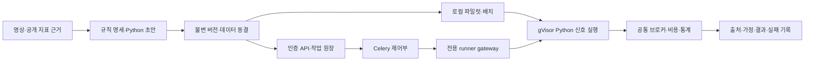

# Python 전략 연구·백테스트 계약

설계 결정은 [ADR-045](../adr/045-python-strategy-research.md), 로컬 연구 명령은
[`tools/research/README.md`](../../tools/research/README.md), 실행기 준비·SDK는
[`infra/python-runner/README.md`](../../infra/python-runner/README.md)가 갖는다.

## 실행 흐름

웹 경로는 `/strategies/python`, API는 `/api/v1/python-strategies`다. Pine의 기존 편집·파싱·커버리지·
라이브 경로와 Python 연구 원장을 분리한다. 사용자 코드는 API 핸들러·Celery 프로세스에서 실행하지 않는다.
DB 접근·소유권 조회는 `python_strategy/repository.py`만 담당한다.

## 저장·버전·작업

코드 저장은 AST 구문과 `on_bar` 진입점 검사이며 안전성·수익성 통과가 아니다. 이름·소스·scalar 파라미터·
워밍업 봉 수를 저장하고 수정마다 새 불변 버전을 만든다. 실행 요청의 `expected_version_id`가 최신 버전과
다르면 409를 반환한다. 이미 제출된 작업은 제출 시점의 버전에서 실행한다.

제출은 202와 작업 ID를 반환한다. 상태는 `pending → running → completed/failed`, 취소는 조건부 갱신이다.
pending 취소는 pending-only CAS로 worker claim과 경합하고, running 취소는 gateway에 tombstone·종료를
전달한 뒤 상태를 바꾼다. 취소된 결과가 늦게 도착해도 완료 상태로 덮어쓰지 않는다. 사용자당 활성 작업은
1개, gateway 동시 실행도 1개다. 30분 지난 대기·실행 작업은 주기적으로 실패 처리한다.

## 데이터·비용

첫 버전의 시장은 Bybit BTC·ETH USDT 무기한, 봉은 1h·4h·1d다. 기간은 UTC 봉 경계의 [시작, 끝)이며
미마감 봉을 허용하지 않는다. 요청 기간 앞에 워밍업을 확보하고 누락·중복·가격 관계·실제 기간을 검사한다.
단축된 기간을 정상 요청 기간으로 표시하지 않는다. 이 검사는 Python 연구 경로의 경계이며 기존
TimescaleProvider 전체의 [BL-842]가 종결됐다는 뜻은 아니다.

기본값은 자본 10,000 USDT, 1배, 단일 포지션, 자본 100%, 다음 봉 시가 체결이다. 실제 실행 config와
수수료·슬리피지·펀딩을 결과에 기록한다. BTC·ETH UTC 00/08/16시 grid는 초기 수집의 **과거 정산 일정 가정**이다.
관측 누락을 차단해도 `observed_settlements_only`를 유지하며 전체 역사 일정의 입증이라고 부르지 않는다.
봉 내부 TP/SL과 정산 순서를 확정하지 못하면 부분 비용 성과를 통과시키지 않는다.
초기 공통 엔진은 빈 펀딩 자료를 허용하지 않으므로 요청 기간에 정산 시각이 최소 1회 있어야 한다.
펀딩 금액 산정은 공통 엔진의 봉 가격 모형이며 실제 정산 시점 mark price를 재현한다는 뜻이 아니다.

## 출처·선별

제공된 6개 한국어 YouTube 채널을 우선 조사하고 공개 TradingView 원문을 연결한다. 목록·설명·자막 track의
존재를 읽은 것과 영상 전체의 규칙을 확인한 것을 구분한다. source registry에는 URL·게시일·관측 시각·
설정·진입·청산·손절·권한·미확인 규칙을 남긴다. 로그인은 필요한 페이지에서 사용자에게 요청하고,
비공개 코드나 원문이 없는 자료를 원본 재현이라고 표시하지 않는다.

연구 카탈로그는 역할이 다른 필터 10종 × 진입 신호 10종의 **독립 연구 가설 100개**다. 파라미터만 바꾼
복제를 세지 않으며 영상 원본 100개를 재현했다는 뜻이 아니다. 최초 10개 × 12개 개발 셀을 끝낸 뒤
100개 × 12개로 확대한다. 영상에서 추출한 규칙과 프로젝트가 추가한 규칙은 따로 기록한다.
여기서 독립은 별도 규칙·소스를 가진 후보라는 뜻이며 통계적 독립성이 아니다. 조합 간 상관이 있고
3개월 창은 6개월 창에 포함된다. 1,200회 탐색의 수치선 통과율은 유의확률이나 수익 보장이 아니다.

24개월과 워밍업을 동결하고 마지막 6개월을 후보 선택에서 분리한다. 그 이전 3·6개월 창을 비교한다.
미래를 각 시점에 넘기지 않는 것과 과거 holdout의 독립성을 입증하는 것은 별개다. 과거 별도 기간은
`retrospective_not_untouched`이며 파일을 수동 열람했다면 독립 평가로 주장할 수 없다.

비용 후 수익 > 0·PF ≥ 1.1·|MDD| ≤ 25%·완료 거래 ≥ 30회가 초기 수치선이다. 일봉 표본 부족과
자료 부족은 별도 사유로 표시한다. 비용 2배는 참고용이며 펀딩을 2배로 늘리지 않는다. 후보 선택과
별도 기간 개봉은 기록으로 고정하고 실패 후 같은 기간을 새 미사용 구간으로 재사용하지 않는다.
별도 기간 평가 후 `tools/research/export_candidate.py`로 코드·저장 요청·원본 결과·hash를 검토 묶음으로
내보낸다. 수치선 미달도 실패 근거를 포함해 내보내며 서버에 자동 등록하지 않는다.

## 두 봉 스윙 청산 정책

2026-10-21 사용자 규칙은 **같은 시간봉의 직전 완료 봉 두 개**를 참조한다. 롱은 두 저가의
최솟값 L, 숏은 두 고가의 최댓값 H를 사용한다. 두 가격을 산술 합산하지 않는다.
진입가 E를 기준으로 롱 SL은 `E - 1.1 × (E-L)`, 숏 SL은 `E + 1.1 × (H-E)`다.
최초 `R = |E-SL|`은 포지션 동안 고정한다. 갭으로 스윙 가격이 손실 방향에 없으면 해당 진입을
거부하고 사유를 남기며 임의 SL을 만들지 않는다.

1. `1.5R` 수익 가격에 최초 수량의 50% 익절 예약을 둔다.
2. `2R`에서 잔량의 트레일링을 활성화한다. 추적 간격이 `2R`이므로 활성화 순간 SL은 진입가다.
3. 이후 롱은 최고가에서 `2R` 아래, 숏은 최저가에서 `2R` 위로 추적하며 불리한 방향으로 되돌리지 않는다.
4. 같은 방향의 반복 신호는 추적 상태를 초기화하지 않는다. 반대 진입 신호의 반전·새 포지션은 새 계획을
   만들고 이전 예약을 폐기한다. 명시적 계획 교체도 generation으로 구분한다. 이미 체결된 수량은 복원하지
   않고 잔량에 새 계획을 적용하며, 구세대 TP·SL·트레일링·close 이벤트는 거부한다.

예: E=100, L=95이면 SL=94.5, R=5.5, 반익절=108.25, 활성가=111, 추적 간격=11이다.
최고가가 116이 되면 SL은 105다. 진입가에서의 청산은 수수료·슬리피지 후 순손익 0을 보장하지 않는다.

이 선택형 경로는 기존 지표의 **진입 규칙**에 새 청산을 적용한다. 기존 `close`·고정 2%/4% 청산과
신호의 SL/TP는 새 정책으로 대체한다. 청산 시점에 따라 후속 진입 횟수도 달라지므로 동일한 진입 규칙과
완전히 같은 거래 목록을 혼동하지 않는다. 반익절·잔여 청산은 원래 포지션 한 건으로 묶어 PF·승률·완료
거래 수를 집계한다. 개별 청산 체결은 별도 원장에 남긴다.

비교 기준은 원본 소스의 청산을 **같은 새 원장으로 다시 실행한 결과**다. 두 정책에 동일한 순자산
기준 수량·수수료·슬리피지·펀딩·1분봉 종가 MDD를 적용한다. 앞선 1,200개 스냅샷은 원장과 해상도가
다르므로 참고 자료로만 남긴다. 원본은 보유 중 반대 신호에 청산만 하지만 새 정책은 조건을 만족하는
반대 진입 신호에 같은 다음 시가에서 반전한다. 따라서 청산 가격만의 차이가 아니라 청산·반전·재진입
정책 전체의 비교다.

다음 봉 시가 진입은 신호 봉과 그 직전 봉을 참조한다. 해당 시가 직전 보유 잔량에 먼저 펀딩을 적용하고
대기 시장가를 체결한다. 펀딩 가격은 1분봉 시가 대용값이며 실제 정산 mark price·거래소 동시 사건 순서의
재현이 아니다. 반익절 이후에는 잔량에만 펀딩을 적용한다. 미청산 포지션은 마지막 종가로 평가하고
완료 거래 수에 넣지 않는다.

지표 계산은 원래 시간봉, 체결 재생은 별도 1분봉으로 수행한다. 확정된 참조 봉만 전략에 전달하고
신호 이전 분봉에 보호주문을 소급하지 않는다. 같은 분봉 안의 실제 틱 순서는 알 수 없으므로
`O-H-L-C`와 `O-L-H-C`의 **비용 전 평가손익**을 비교해 불리한 경로를 택하고 모호한 분봉 수를 남긴다.
이는 실제 틱 경로나 모든 가능한 경로의 최악값을 입증하는 것이 아니다. 새 추적 SL을 만들어 놓고
그보다 먼저 발생한 시가에 청산됐다고 기록하지 않는다.

새 실험은 별도 `runs/` 디렉터리와 정책·데이터·코드 해시를 사용한다. 앞선 1,204개 결과는 보존한다.
기존 개발 기간을 다시 쓰는 비교와 이미 개봉한 최종 기간을 재사용하는 비교는 과거 재분석이며,
새로운 독립 최종 평가로 표시하지 않는다. 이 경로는 우선 로컬 연구용이며 웹 Python 출력 계약이나
Bybit 데모 주문의 단계별 청산 관리자를 자동으로 확장하지 않는다.
연구 실행기의 세션 필터·Pine 입력 override는 미지원으로 거부한다. live 비중은 `None/100`만 허용하며,
별도 수량은 명시적 `default_qty_type/default_qty_value`를 사용한다.

Pine의 `strategy.exit(qty=.../qty_percent=...)`는 현재 수량 의미를 구현하지 않았으므로 미지원으로
거부한다. 이를 무시해 전량 청산을 성공 성과로 표시하던 경로는 정적 검사와 실행 경계 양쪽에서 차단한다.

## 운영 준비

앱·기본 Celery 워커에 `PYTHON_RUNNER_URL`·`PYTHON_RUNNER_TOKEN`을 설정한다. 모두 `.env.example`에
선언하며 토큰은 `SecretStr`로 읽는다. 비우거나 health probe가 실패하면 코드 저장은 가능하지만 실행은
503으로 차단한다. 전용 실행기에는 프로젝트 `.env`·앱 DB·거래소·LLM 키를 복사하지 않는다.

로컬 워크트리에서 CSV와 직접 runner 호출로 검증한다. 공유 Celery로 검증하면 메인 코드가 실행되므로
사용하지 않는다. 새 DB 테이블은 migration 파일로 제공한다. 서버 DDL·배포는 검증 결과와 반영 대상을
준비한 뒤 사용자 승인을 받아 수행한다. 서버 백테스트 등록은 데모 주문 활성화를 뜻하지 않는다.
