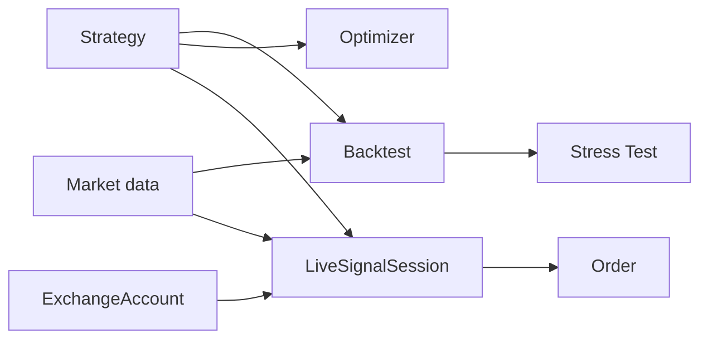

# QuantBridge 도메인 개요

> **역할:** 도메인 경계와 책임의 짧은 지도. 구현은 `apps/api/src/<domain>/`, DB 관계는 [`erd.md`](./erd.md), 상태 전이는 [`state-machines.md`](./state-machines.md), API 경계는 [`endpoints.md`](../api/endpoints.md)가 정본이다.

용어 정의는 루트 [`GLOSSARY.md`](../../GLOSSARY.md)를 따른다.

## 경계

| 도메인        | 책임                                                 | 주요 영속 모델                            |
| ------------- | ---------------------------------------------------- | ----------------------------------------- |
| `auth`        | JWT 검증(JWKS)과 사용자 원장·탈퇴                    | User                                      |
| `strategy`    | Pine 등록·파싱·지원 범위·`pine_v2` 실행 준비         | Strategy                                  |
| `backtest`    | 비동기 실행과 결과·거래 보관                         | Backtest, BacktestTrade                   |
| `market_data` | OHLCV·Funding 수집과 TimescaleDB 보관                | OHLCV, FundingRate                        |
| `stress_test` | Monte Carlo·Walk-Forward·민감도 분석                 | StressTest                                |
| `optimizer`   | Grid·Bayesian·Genetic 탐색                           | OptimizationRun                           |
| `trading`     | Demo 계정·주문·리스크·Kill Switch·LiveSignal session | ExchangeAccount, Order, LiveSignalSession |
| `realtime`    | 브라우저 WebSocket fan-out                           | 영속 모델 없음                            |
| `waitlist`    | Beta 전 대기자 접수                                  | WaitlistApplication                       |

`exchange`는 별도 도메인이 아니다. 거래소 계정과 provider dispatch는 `trading`이 소유한다.

## 공통 규칙

- 의존성 방향은 Router → Service → Repository다. DB 접근은 Repository만 담당한다.
- Backtest·Stress Test·Optimizer는 Celery 비동기로 실행한다.
- 금융값은 경계에서 `Decimal`을 사용하며, Pine 실행은 `pine_v2` 인터프리터가 맡는다.
- Pine 미지원 항목은 부분 실행하지 않는다. 지원 집합은 [`supported-indicators.md`](./supported-indicators.md)의 코드 정본을 따른다.
- 사용자·전략·계정·세션의 FK와 delete 정책은 [`erd.md`](./erd.md)를 확인한다. 모든 엔티티의 소유권은 User 단위다.

## 핵심 연결

- Backtest는 전략의 실행 결과를 보관한다. 일반 Pine은 `pine_v2`, Code Strategy는 고정 버전의 격리 실행기와 공통 원장을 사용한다.
- Stress Test·Optimizer는 Backtest 계약을 재사용한다.
- LiveSignalSession과 Order가 자동매매 lifecycle을 표현한다. 과거 `trading_sessions`·`live_trades` 모델은 구현된 테이블이 아니며 재사용하지 않는다.
- LiveSignalSession은 Strategy와 ExchangeAccount를 참조하며 Backtest FK는 없다. 라이브와 백테스트는 같은 `strategy_id`로 대조한다. LiveSignalEvent 하나는 최대 한 Order로 발송된다.
- OHLCV는 Backtest의 배치 Provider와 Trading의 실시간 WebSocket 경로에 공급된다. `market_data`는 공개 REST가 없는 내부 전용 도메인이다.

## 실행 계약 찾아보기

| 경계 | 정본과 주의점 |
| --- | --- |
| Pine 실행·소비자 | [Pine 실행 아키텍처](../architecture/pine-execution-architecture.md). 신호와 라이브 조건부 체결의 권한, 파싱·지원 판정, 세 소비자의 재실행 경계를 확인한다. |
| 브리핑·생성·읽기 뷰 | [전략 작성 계약](../development/strategy-authoring.md). 실행 판정과 LLM 설명, 읽기 전용 Python과 실행 Python을 구분한다. |
| Code Strategy | [저장·실행 계약](../development/code-strategy-storage.md). `execution_policy=code_v1`의 불변 버전과 격리 실행기를 사용하며, 공통 원장이 수량·SL·반익절·트레일링을 소유한다. |
| 과거 Python 연구 전략 | [연구 범위](../development/python-strategy-research.md)와 [ADR-045](../adr/045-python-strategy-research.md). 과거 모델·마이그레이션은 이력 보존용이며 Python View·현재 Code Strategy와 다르다. |
| 생성 언어 평가 | [ADR-046](../adr/046-generated-strategy-language-evaluation.md)과 [평가 보고서](../architecture/generated-strategy-evaluation.md). 봉인 품질 평가의 권고와 운영·경제 검증 범위를 구분한다. |
| 거래소 정책 | [상품·심볼 경계](./instrument-symbol-boundary.md). `trading/registry.py`의 `PROVIDER_REGISTRY`가 `(ExchangeName, ExchangeMode, has_leverage)`로 dispatch하며 Bybit Demo의 spot·linear만 등록한다. 과거 live·다른 거래소 enum은 이력 호환용이고 자격증명 복호화·외부 호출 전에 차단한다. |
| 주문·손익보호 | [엔티티](./entities.md)와 [상태 전이](./state-machines.md). 계정 키는 암호화 보관·응답 마스킹하며, 트레일링 의도는 진입 주문에 넣지 않고 체결 후 포지션에 부착한다. 현재 bracket의 형제 취소는 거래소 네이티브 OCO가 담당한다. |
| Kill Switch | [ERD](./erd.md)의 `kill_switch_events`. 미해결 이벤트가 활성 상태이며 누적 손실은 전략, 일 손실·API 오류는 계정 단위다. 모든 발주 전에 검사한다. |

`strategy/trading_sessions.py`의 `TradingSession`은 asia/london/ny 시간대 게이트의 enum이며 자동매매 세션 엔티티가 아니다.
LiveSignalSession의 활성 수는 사용자당 최대 5개다.
Optimizer는 Grid·Bayesian(scikit-optimize)·자체 Genetic 탐색을 사용한다. 결번 ADR-013의 원문은 `git show 94da86b1^:docs/dev-log/2026-05-12-sprint54-bayesian-genetic-grammar-adr.md`로 조회한다.

## 새 도메인을 추가할 때

1. `apps/api/src/<domain>/`의 코드 경계를 먼저 정한다.
2. router 등록, schema, repository, migration과 테스트를 함께 추가한다.
3. API 기준 경로가 새로 생기면 [`endpoints.md`](../api/endpoints.md)를 갱신한다.
4. 영속 관계나 상태가 새로 생기면 ERD·상태 머신을 같은 변경에서 갱신한다.
